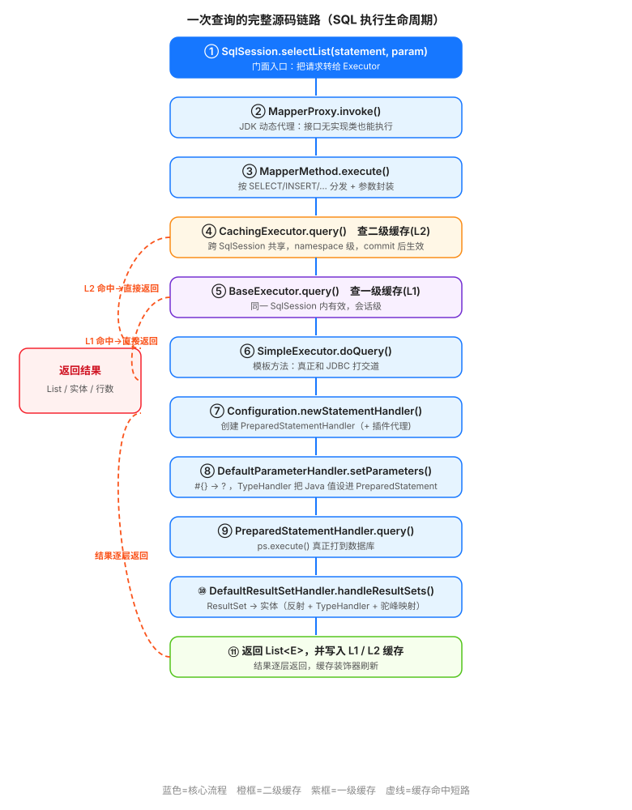
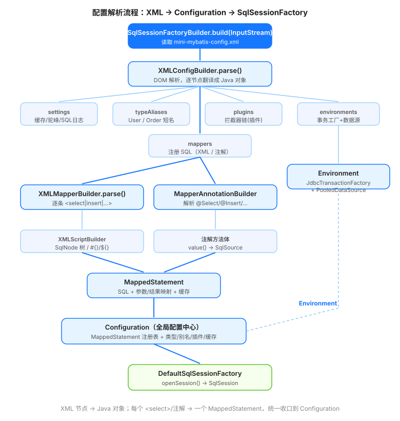
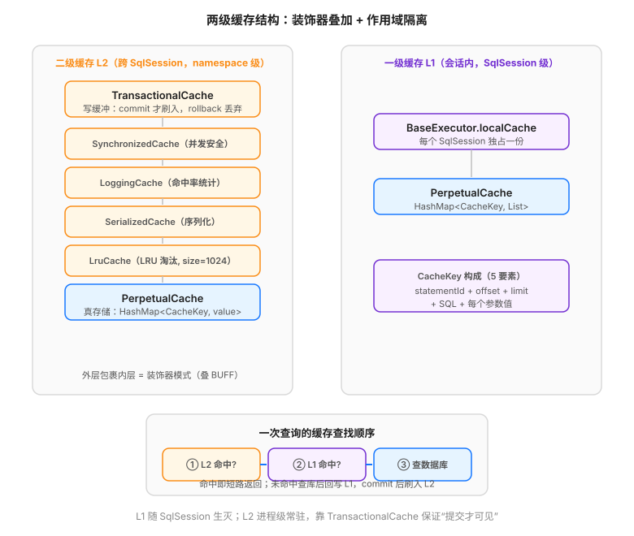

# mini-mybatis · 手写简化版 MyBatis（源码学习项目）

> 一个**面向 Java 初学者**的 MyBatis 源码学习项目：不依赖任何第三方 ORM 框架，用最朴素的 Java 代码，**逐层实现 MyBatis 的核心模块**，把「配置解析 → 动态 SQL → Mapper 代理 → 执行器 → 参数/结果处理 → 两级缓存 → 插件」这条完整链路亲手走一遍。
>
> 每个类都带有**详尽的的中文注释**，讲清「为什么这样设计、对应 MyBatis 里的哪一块、用了什么设计模式」。读代码即读教程。

---

## 一、这个项目能带你搞懂什么

| 你写业务时常用的能力 | 本项目对应的源码层 |
| --- | --- |
| `mybatis-config.xml` 配置 | `builder/XMLConfigBuilder` —— DOM 解析成 `Configuration` |
| `Mapper.xml` 里的 `<if>/<foreach>/<choose>` | `scripting/*` —— 动态 SQL 的 SqlNode 树 |
| `#{}` 防注入占位符 / `${}` 拼接 | `parsing/GenericTokenParser` + `SqlSourceBuilder` |
| 接口没有实现类却能执行 SQL | `binding/MapperProxy`（JDK 动态代理） |
| 查询怎么打到数据库 | `executor/*` + `executor/statement/*` |
| 结果集自动映射成实体 | `executor/statement/DefaultResultSetHandler` |
| 一级 / 二级缓存 | `cache/*` + `executor/CachingExecutor` |
| 慢 SQL 监控、分页插件 | `plugin/*`（拦截器链，责任链 + 动态代理） |
| 连接池 | `datasource/PooledDataSource` + `PooledConnection` |

---

## 二、分层学习路线（按依赖从下往上）

代码严格分层，**下层不依赖上层**，建议按 L1→L12 的顺序阅读：

| 层 | 包（package） | 主题 | 关键点 |
| --- | --- | --- | --- |
| L1 | `type` / `io` / `logging` | 地基 | `TypeHandler`（Java↔JDBC 类型转换）、`Resources` 读资源、`MiniLog` 日志 |
| L2 | `reflection` | 反射工具箱 | `Reflector`（缓存反射元数据）、`MetaObject`（统一读写任意对象） |
| L3 | `datasource` / `transaction` | 数据源与事务 | 连接池、连接代理、`JdbcTransaction`（autoCommit/commit/rollback） |
| L4 | `mapping` / `builder` | 配置与映射模型 | `MappedStatement`、`BoundSql`、`XMLConfigBuilder` |
| L5 | `scripting` | 动态 SQL | `SqlNode` 树、`#{}/${}` 解析、`ExpressionEvaluator` |
| L6 | `binding` | Mapper 代理 | `MapperProxy`（JDK 动态代理）、`ParamNameResolver` |
| L7 | `cache` | 两级缓存 | `PerpetualCache`、`LruCache`、`TransactionalCache` |
| L8 | `executor` | 执行器 + Handler | `BaseExecutor`（模板方法）、`SimpleExecutor`、`CachingExecutor`、各 StatementHandler |
| L9 | `plugin` | 插件机制 | `InterceptorChain` + `Plugin`（动态代理责任链） |
| L10 | `session` | 门面 | `SqlSessionFactoryBuilder` → `SqlSessionFactory` → `SqlSession` |
| L11 | `demo` | 端到端演示 | 一个能直接 `main` 跑起来的完整示例 |
| L12 | `docs` + 本文件 | 图解与文档 | SVG 流程图 + 这份 README |

---

## 三、目录结构

```
mybatis-source-learn/
├── pom.xml                         # Java 17 + Maven + H2 内存库 + exec 插件
├── README.md                       # 你正在看的这份文档
├── docs/
│   ├── sql-lifecycle.svg           # 一次查询的完整源码链路
│   ├── config-parse-flow.svg       # 配置解析流程：XML → Configuration
│   └── cache-structure.svg         # 两级缓存结构与装饰器叠加
└── src/main/
    ├── java/com/learn/mybatismini/
    │   ├── annotations/            # @Select/@Insert/@Update/@Delete/@Param/@Options/@CacheNamespace
    │   ├── binding/                # MapperProxy / MapperMethod / MapperRegistry
    │   ├── builder/                # XMLConfigBuilder / XMLMapperBuilder / SqlSourceBuilder ...
    │   ├── cache/                  # Cache 接口 + PerpetualCache + decorators(Lru/Fifo/Transactional)
    │   ├── datasource/             # Unpooled / Pooled 数据源 + PooledConnection 代理
    │   ├── executor/               # Base/Simple/Caching/Reuse Executor + keygen + statement/*
    │   ├── io/  logging/  exceptions/
    │   ├── mapping/                # MappedStatement / BoundSql / ResultMap / Environment ...
    │   ├── parsing/                # GenericTokenParser（#{}/${} 解析核心）
    │   ├── plugin/                 # Interceptor / InterceptorChain / Plugin（AOP 代理）
    │   ├── reflection/             # Reflector / MetaObject / ObjectFactory / property 解析
    │   ├── scripting/              # 动态 SQL：If/Where/Set/ForEach/Choose/Trim + 解析器
    │   ├── session/                # Configuration / SqlSession / *Factory / defaults
    │   ├── transaction/            # JdbcTransaction + 工厂
    │   ├── type/                   # JdbcType + 各 TypeHandler + TypeHandlerRegistry + TypeAliasRegistry
    │   └── demo/                   # 演示层（实体/接口/插件/MainApplication）
    └── resources/
        ├── mini-mybatis-config.xml # 全局配置（settings / 别名 / 插件 / 环境 / mappers）
        ├── mapper/                 # UserMapper.xml / OrderMapper.xml
        └── db/schema.sql           # 内存库建表 + 种子数据
```

---

## 四、编译与运行

> 环境要求：**JDK 17+**、**Maven 3.8+**（已配置 `exec-maven-plugin`，无需单独安装依赖到本地）。
> 数据库用 **H2 内存库**（`MODE=MySQL`，纯内存、零安装），`db/schema.sql` 在启动时自动执行。

```bash
# 进入项目根目录
cd mybatis-source-learn

# 编译并直接运行端到端 Demo（Step01 ~ Step14）
mvn -q clean compile exec:java
```

运行成功会看到一段仿 MyBatis 的 SQL 日志，例如：

```
==>  Preparing: SELECT id, user_name, age, email, create_time FROM t_user WHERE id = ?
==> Parameters: 1(Long)
<==      Total: 1
   selectById(1) => User{id=1, userName='张三', age=18, ...}
```

---

## 五、端到端 Demo 都演示了什么（Step01 ~ Step14）

`demo/MainApplication.java` 的 `main` 方法按 14 步把核心模块串起来：

| Step | 演示点 | 关键源码 |
| --- | --- | --- |
| 01 | 配置解析：XML → Configuration → SqlSessionFactory | `XMLConfigBuilder` |
| 02 | 基础查询 `selectById` / `selectAll` | `PreparedStatementHandler` + `DefaultResultSetHandler` |
| 03 | 动态 SQL `<where>` + `<if>` | `WhereSqlNode` / `IfSqlNode` |
| 04 | 动态 SQL `<foreach>` 展开成 `IN (?, ?, ?)` | `ForEachSqlNode` |
| 05 | 动态 SQL `<choose>/<when>/<otherwise>` | `ChooseSqlNode` |
| 06 | 插入 + 自增主键回填 `useGeneratedKeys` | `Jdbc3KeyGenerator` |
| 07 | 动态 `<set>` 更新（只改非 null 字段） | `SetSqlNode` |
| 08 | `@Param` 多参 + 计数 | `ParamNameResolver` |
| 09 | `${}` 字符串拼接排序（含 SQL 注入风险说明） | `TextSqlNode` |
| 10 | 一级缓存（同会话重复查询命中） | `BaseExecutor.localCache` |
| 11 | 二级缓存（跨会话共享，需 commit） | `CachingExecutor` + `TransactionalCache` |
| 12 | 注解式 Mapper（`@Select`/`@Insert`/`@CacheNamespace`） | `MapperAnnotationBuilder` |
| 13 | 插件机制（慢 SQL 耗时统计，全程生效） | `InterceptorChain` + `Plugin` |
| 14 | SQL 执行生命周期总结 | 见下方图解 |

---

## 六、核心源码流程图解

### 6.1 一次查询的完整源码链路（SQL 执行生命周期）

> 从 `SqlSession.selectList` 一路走到 JDBC，再经结果映射返回，并写入两级缓存。



### 6.2 配置解析流程：XML → Configuration → SqlSessionFactory

> 配置文件中的每个节点被翻译成对应的 Java 对象；每条 `<select>` / 注解 最终收敛成一个 `MappedStatement`，统一存放在 `Configuration`。



### 6.3 两级缓存结构

> 二级缓存用**装饰器模式**层层包裹（从外到内：事务缓冲 → 同步 → 日志 → 序列化 → LRU → 真存储）；一级缓存是会话私有的 `PerpetualCache`。查询顺序：L2 → L1 → 数据库。



---

## 七、贯穿全项目的设计模式（面试常考）

| 模式 | 出现位置 | 作用 |
| --- | --- | --- |
| **工厂模式** | `SqlSessionFactoryBuilder` / `SqlSessionFactory` | 屏蔽复杂构建过程 |
| **建造者模式** | `XMLConfigBuilder` / `XMLMapperBuilder` | 一步步解析 XML 拼出 `Configuration` |
| **门面模式** | `SqlSession` | 对外只暴露简单 API，内部转发给 Executor |
| **模板方法** | `BaseExecutor` / `BaseStatementHandler` | 固定「不变流程」，子类填「变化点」 |
| **策略模式** | `SimpleExecutor` / `ReuseExecutor`、`SimpleStatementHandler` / `PreparedStatementHandler` | 同一接口多种实现，运行时切换 |
| **装饰器模式** | `cache/decorators/*` | 给缓存叠加 LRU/日志/事务等能力 |
| **动态代理** | `MapperProxy` / `Plugin` / `PooledConnection` | 接口无实现类也能执行；无侵入插桩 |
| **责任链模式** | `InterceptorChain` | 多个插件依次包裹核心对象 |
| **组合模式** | `MixedSqlNode` / SqlNode 树 | 把动态标签递归拼成完整 SQL |
| **享元模式** | `TypeAliasRegistry` / `ReflectorFactory` | 缓存反射元数据，避免重复计算 |

---

## 八、几个「初学者最容易踩的坑」（本项目已逐一验证）

1. **`PreparedStatement` 必须显式 `execute()`**：只创建+设参还不够，漏掉执行步骤会导致 `getResultSet()` 永远为 `null`，所有查询都会「查到 0 行」。（本项目早期版本就踩过这个坑，已在 `PreparedStatementHandler.query` 修正。）
2. **`<foreach>` 的 `#{item}` 必须重新包回 `#{}`**：foreach 把 `#{id}` 改写成 `#{__frch_id_0}` 后，外层 `SqlSourceBuilder` 才能把它变成 `?` + 参数映射；只替换文本不包回 `#{}` 会报 `Column __FRCH_ID_0 not found`。
3. **`${}` 有 SQL 注入风险**：它直接字符串拼接，只能用于列名/排序字段等「结构部分」，绝不可拼接用户输入（见 Step09 演示）。
4. **`openSession()` 默认 `autoCommit=false`**：插入后忘记 `commit`，连接一关事务就回滚，数据「看起来插进去了实际没了」。
5. **H2 内存库 `DB_CLOSE_DELAY=-1`**：保证跨会话（连接归还后）内存库不丢失，否则 Demo 里 Step11 二级缓存演示会拿不到数据。

---

## 九、如何基于本项目继续深入

- 想加功能：试着实现 `ReuseExecutor`（复用 Statement）、`BatchExecutor`（批量）、`<bind>` 标签、`<resultMap>` 的 `association` 嵌套映射。
- 想看真源码：本项目每个类的 Javadoc 都标了「对应 MyBatis 的 `xxx`」，直接拿去和官方源码对照读，事半功倍。
- 想接真实库：把 `mini-mybatis-config.xml` 里的 `POOLED` 数据源换成 MySQL 连接串即可（SQL 语法已基本对齐 MySQL）。

---

*本项目仅用于学习 MyBatis 核心原理，非生产级实现，请勿直接用于生产环境。*
