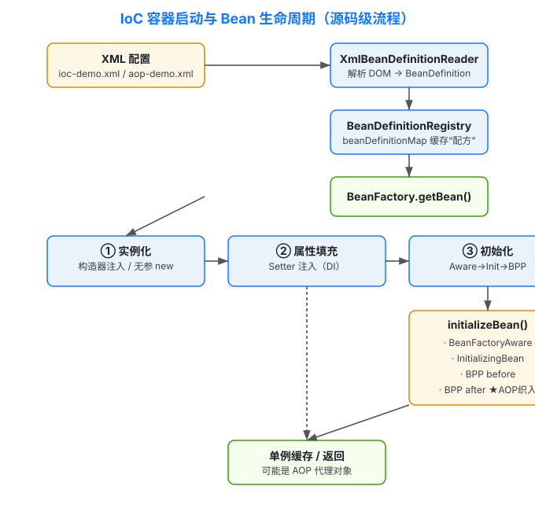
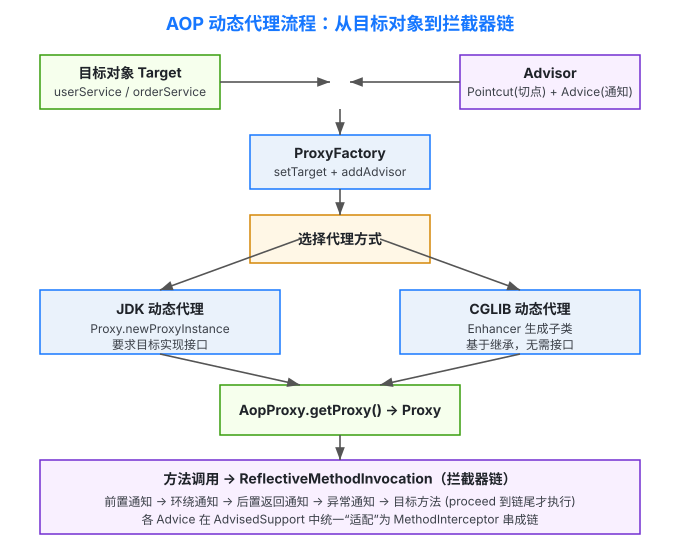
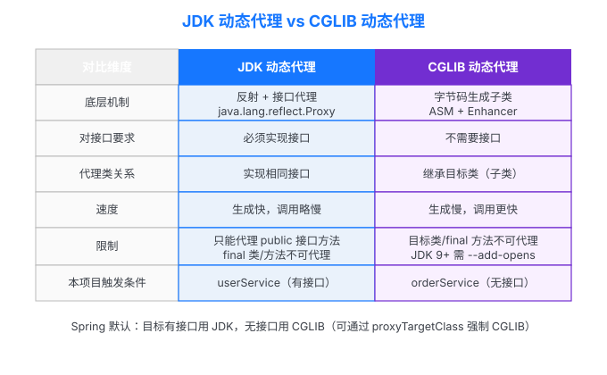
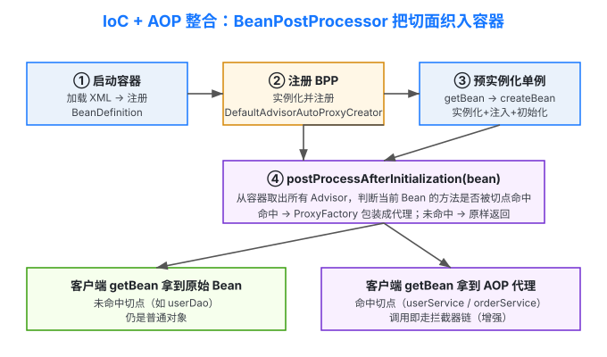

# Spring IoC & AOP 手写学习项目（迷你 Spring）

> 面向 Java 初学者的**源码级**学习案例：不依赖 Spring 框架本身，而是从零手写一套迷你 IoC 容器与 AOP 框架，
> 直观演示 **控制反转（IoC）** 与 **面向切面编程（AOP）** 的核心原理与底层实现机制。

本项目全部代码带**详细中文注释**，每一处设计都对应 Spring 中真实的抽象（如 `BeanFactory`、`BeanDefinition`、
`BeanPostProcessor`、`AdvisedSupport`、`MethodInterceptor` 等），非常适合用来“看懂 Spring 到底是怎么运转的”。

---

## 一、环境要求

| 工具 | 版本 | 说明 |
| --- | --- | --- |
| JDK | 17+ | 项目按 Java 17 编译（也兼容 8/11，改 `pom.xml` 的 `maven.compiler.release` 即可）|
| Maven | 3.6+ | 用于编译与运行 |
| 依赖 | 仅 `cglib 3.3.0` | 用于演示 CGLIB 动态代理；JDK 动态代理是 JDK 原生，无需依赖 |

> ⚠️ **关于 CGLIB 与 JDK 模块系统**：CGLIB 3.3.0 在 JDK 9+ 需要用反射访问 JDK 内部包来生成代理子类，
> 因此项目根目录的 **`.mvn/jvm.config`** 已统一配置好 `--add-opens` 参数，正常情况下你无需关心。
> 如果脱离 Maven 用 `java -cp ...` 直接运行，需要自己在命令行加上这些 `--add-opens` 参数
> （README 末尾“脱离 Maven 运行”一节有完整命令）。

---

## 二、目录结构

```
spring-ioc-aop-learn/
├── pom.xml                         # Maven 配置（含 cglib 依赖、exec 插件、编译版本）
├── .mvn/
│   └── jvm.config                  # 为 CGLIB 在 JDK9+ 打开必要内部包（无需手动改）
├── docs/                           # SVG 图解（见第七节）
│   ├── ioc-container-flow.svg      # IoC 容器启动与 Bean 生命周期
│   ├── aop-proxy-flow.svg          # AOP 动态代理流程
│   ├── proxy-compare.svg           # JDK 代理 vs CGLIB 代理对比
│   └── integration-flow.svg        # IoC + AOP 整合流程
├── src/main/
│   ├── resources/
│   │   ├── ioc-demo.xml            # 纯 IoC 演示配置（构造器注入 + Setter 注入）
│   │   └── aop-demo.xml            # IoC + AOP 整合配置（自动代理织入）
│   └── java/com/learn/springmini/
│       ├── ioc/                    # —— 手写的迷你 IoC 容器 ——
│       │   ├── BeansException.java / NoSuchBeanDefinitionException.java
│       │   ├── BeanFactory.java            # 容器根接口（getBean）
│       │   ├── ListableBeanFactory.java    # 按类型批量查 Bean
│       │   ├── SingletonBeanRegistry.java  # 单例缓存
│       │   ├── BeanDefinitionRegistry.java # BeanDefinition 注册表
│       │   ├── InitializingBean.java / BeanFactoryAware.java / BeanPostProcessor.java
│       │   ├── AbstractBeanFactory.java    # getBean 模板方法 + 单例/定义表
│       │   ├── AbstractAutowireCapableBeanFactory.java  # 创建/注入/生命周期
│       │   ├── DefaultListableBeanFactory.java          # 汇总实现
│       │   ├── BeanDefinitionReader.java / XmlBeanDefinitionReader.java
│       │   ├── ClassPathXmlApplicationContext.java      # 应用上下文门面
│       │   ├── beans/              # BeanDefinition / PropertyValue / ConstructorArgumentValue / BeanReference 等“配方”模型
│       │   └── util/               # TypeConverter（字符串→目标类型）/ BeanUtils（找 setter/构造函数）
│       ├── aop/                    # —— 手写的迷你 AOP 框架 ——
│       │   ├── Advice / MethodBeforeAdvice / AfterReturningAdvice / ThrowsAdvice / MethodInterceptor / MethodInvocation
│       │   ├── Pointcut / ClassFilter / MethodMatcher / Advisor / PointcutAdvisor / DefaultPointcutAdvisor
│       │   ├── AdvisedSupport.java         # 配置中心：构建拦截器链（核心）
│       │   ├── AopProxy / ProxyFactory / AopProxyUtils
│       │   ├── framework/          # ReflectiveMethodInvocation（调用链）/ JdkDynamicAopProxy / CglibAopProxy
│       │   ├── framework/adapter/  # 把前置/后置/异常通知“适配”成统一拦截器
│       │   ├── pointcut/           # NameMatchMethodPointcut（按方法名匹配）
│       │   └── autoproxy/          # DefaultAdvisorAutoProxyCreator（把 AOP 织入 IoC 的缝合点）
│       └── demo/                   # —— 演示代码 ——
│           ├── IoCDemo.java / AopDemo.java / MainApplication.java
│           ├── service/            # UserService/UserServiceImpl（有接口→JDK代理）、OrderServiceImpl（无接口→CGLIB代理）
│           ├── dao/                # UserDao/UserDaoImpl
│           └── aspect/             # 四种自定义通知（前置/后置返回/环绕/异常）
```

---

## 三、各模块职责一句话总结

- **IoC 容器**：负责“对象怎么造、依赖怎么给”。`XmlBeanDefinitionReader` 把 XML 解析成 `BeanDefinition`（配方），
  容器按配方实例化、注入依赖（构造器/Setter）、执行生命周期回调，最后把成品（或代理）交给调用方。
- **AOP 框架**：负责“横切逻辑怎么织入”。`Pointcut` 决定增强哪些方法，`Advice` 是被织入的逻辑，
  `ProxyFactory` 根据目标是否有接口选择 JDK 或 CGLIB 生成代理，调用时通过 `ReflectiveMethodInvocation` 串成拦截器链。
- **整合层（autoproxy）**：`DefaultAdvisorAutoProxyCreator` 是一个 `BeanPostProcessor`，
  在容器创建好每个 Bean 之后、返回之前，检查是否有 Advisor 命中，命中就把 Bean 换成 AOP 代理——这就是 Spring 自动织入的本质。
- **demo**：用最贴近真实业务的例子把上面所有机制串起来跑给你看。

---

## 四、编译与运行

在项目根目录（`spring-ioc-aop-learn/`）执行：

```bash
# 1) 编译
mvn compile

# 2) 运行三个演示（任选其一，用 -Dexec.mainClass 切换）
mvn compile exec:java -Dexec.mainClass=com.learn.springmini.demo.IoCDemo        # 纯 IoC：构造器注入 + Setter 注入
mvn compile exec:java -Dexec.mainClass=com.learn.springmini.demo.AopDemo         # 纯 AOP：编程式 ProxyFactory（JDK + CGLIB）
mvn compile exec:java -Dexec.mainClass=com.learn.springmini.demo.MainApplication # 整合：IoC 容器中的 Bean 已被 AOP 自动增强
```

> 运行前 Maven 会自动通过 `.mvn/jvm.config` 带上 CGLIB 所需的 `--add-opens` 参数，
> 因此 `mvn exec:java` 开箱即用。若你看到 `InaccessibleObjectException`，说明这些参数没生效，请检查 `.mvn/jvm.config` 是否存在。

### 脱离 Maven 运行（可选）

```bash
mvn dependency:build-classpath -Dmdep.outputFile=/tmp/cp.txt
CP="target/classes:$(cat /tmp/cp.txt)"
java --add-opens java.base/java.lang=ALL-UNNAMED \
     --add-opens java.base/java.lang.reflect=ALL-UNNAMED \
     --add-opens java.base/java.security=ALL-UNNAMED \
     --add-opens java.base/java.util=ALL-UNNAMED \
     -cp "$CP" com.learn.springmini.demo.MainApplication
```

### 期望输出（节选，MainApplication）

```
[userService] 实际类型: jdk.proxy3.$Proxy24          ← JDK 动态代理（因为实现了接口）
  [前置通知] 即将执行方法: createUser，参数=[王五]
  [环绕通知] >>> 进入方法 createUser
  [UserServiceImpl] 应用名=Mini-Spring-AOP，开始创建用户: 王五
    [UserDaoImpl] 持久化用户到数据库: 王五
  [UserServiceImpl] 用户创建完成
  [后置通知] 方法 createUser 执行完毕，返回值=null
  [环绕通知] <<< 离开方法 createUser，耗时=1ms
...
[orderService] 实际类型: ...OrderServiceImpl$$EnhancerByCGLIB$$...   ← CGLIB 动态代理（无接口）
```

---

## 五、IoC 学习要点

1. **什么是控制反转（IoC）**：传统写法是“自己 `new`、自己装配依赖”；IoC 把“创建对象”和“装配依赖”的控制权交给容器。
   你只声明“我需要什么”（XML/注解），容器负责把成品给你。
2. **BeanDefinition 是核心配方**：容器并不持有对象，而是先持有 `BeanDefinition`（类是谁、作用域、构造参数、属性）。
   真正用到时才“按图施工”。这正是配置驱动、可扩展的基础。
3. **依赖注入（DI）的两种主流方式**：
   - **构造器注入**：通过 `<constructor-arg>` 在实例化时把“必需依赖”传进去（本项目 `UserServiceImpl(UserDao)`）。
   - **Setter 注入**：通过 `<property>` 在实例化后调用 `setXxx` 注入“可选配置/依赖”（本项目 `setAppName`）。
   - 容器内部：构造器注入靠 `BeanUtils.findMatchingConstructor` 定位构造函数 + 反射 `newInstance`；
     Setter 注入靠 `BeanUtils.findSetter` 找到 `setXxx` + 反射 `invoke`。
4. **单例与缓存**：`getBean` 先查 `singletonObjects` 缓存，命中直接返回——这就是“单例只创建一次”的实现。
5. **生命周期回调**：实例化 → 属性填充 → `BeanFactoryAware` → `InitializingBean.afterPropertiesSet()`
   → `BeanPostProcessor` 前置 → `BeanPostProcessor` 后置。**AOP 织入就发生在最后一个“后置”钩子里。**

---

## 六、AOP 学习要点

1. **AOP 解决什么问题**：把日志、事务、鉴权这类“横切多个业务方法”的逻辑，从业务代码里抽出来，做到“业务归业务、切面归切面”。
2. **核心概念对照**：

   | 概念 | 本项目类 | 含义 |
   | --- | --- | --- |
   | 切点 Pointcut | `NameMatchMethodPointcut` | 决定“增强哪些类的哪些方法” |
   | 通知 Advice | `MethodBeforeAdvice` 等 | 被织入的横切逻辑（前置/后置/环绕/异常）|
   | 通知器 Advisor | `DefaultPointcutAdvisor` | = 切点 + 通知（最小增强单元）|
   | 代理 Proxy | `Jdk/CglibAopProxy` | 包装目标对象，拦截方法调用 |
   | 调用链 Invocation | `ReflectiveMethodInvocation` | 把多个通知串成链，逐个 proceed |

3. **四种通知的执行顺序**（本项目把链排序为：前置 → 环绕 → 后置返回 → 异常）：
   - 前置通知：目标方法执行**前**
   - 环绕通知：包裹目标方法（可计时、可拦截）
   - 后置返回通知：目标方法**正常返回后**（可拿到返回值）
   - 异常通知：目标方法**抛异常时**
4. **拦截器链的统一**：所有类型的通知在 `AdvisedSupport.getInterceptors()` 里都被“适配”成 `MethodInterceptor`，
   这样前置/后置/异常/环绕就能用同一套 `proceed()` 机制串成洋葱式嵌套调用。
5. **动态代理机制（面试高频）**：

   | | JDK 动态代理 | CGLIB 动态代理 |
   | --- | --- | --- |
   | 底层 | 反射（`Proxy.newProxyInstance` + `InvocationHandler`）| 字节码生成子类（`Enhancer` + ASM）|
   | 要求 | 目标**必须实现接口** | 目标**无需接口**，基于继承 |
   | 本项目触发 | `userService`（有接口）| `orderService`（无接口）|
   | 限制 | 只能代理接口方法 | 目标类/final 方法不能代理；JDK9+ 需 `--add-opens` |

   Spring 的默认策略正是：**目标有接口用 JDK，无接口用 CGLIB**（可用 `proxyTargetClass` 强制 CGLIB）。

6. **关键坑（本项目已处理）**：`Method.invoke` 会把目标方法抛出的异常包成 `InvocationTargetException`，
   本项目在 `ReflectiveMethodInvocation.proceed()` 里“拆包”还原真实异常（与 Spring 一致），
   否则上层看到的是包装异常而不是业务异常。

---

## 七、SVG 图解

> 以下图解与上文代码一一对应，建议配合源码阅读。

- 
- 
- 
- 

---

## 八、建议的阅读顺序（从“懂”到“透”）

1. `demo/service/UserServiceImpl.java` + `resources/ioc-demo.xml` —— 先看“被容器管理的对象长什么样”。
2. `ioc/XmlBeanDefinitionReader.java` → `ioc/beans/*` —— 看配置如何变成内存中的 `BeanDefinition`。
3. `ioc/AbstractAutowireCapableBeanFactory.java` —— **IoC 的灵魂**：`createBean` 里的实例化、注入、初始化三步。
4. `aop/framework/ReflectiveMethodInvocation.java` + `aop/AdvisedSupport.java` —— **AOP 的灵魂**：拦截器链如何构建与执行。
5. `aop/framework/JdkDynamicAopProxy.java` 与 `CglibAopProxy.java` —— 两种代理机制的实现。
6. `aop/autoproxy/DefaultAdvisorAutoProxyCreator.java` —— 看 IoC 与 AOP 如何在 `BeanPostProcessor` 处“合龙”。

---

## 九、与真实 Spring 的对应关系（便于迁移到真框架）

| 本项目 | Spring 框架 |
| --- | --- |
| `ClassPathXmlApplicationContext` | `ClassPathXmlApplicationContext` |
| `BeanDefinition` | `BeanDefinition` |
| `AbstractAutowireCapableBeanFactory` | `AbstractAutowireCapableBeanFactory` |
| `DefaultListableBeanFactory` | `DefaultListableBeanFactory` |
| `BeanPostProcessor` | `BeanPostProcessor` |
| `AdvisedSupport` / `MethodInterceptor` | `AdvisedSupport` / `MethodInterceptor` |
| `JdkDynamicAopProxy` / `CglibAopProxy` | `JdkDynamicAopProxy` / `ObjenesisCglibAopProxy` |
| `DefaultAdvisorAutoProxyCreator` | `AnnotationAwareAspectJAutoProxyCreator` |
| `NameMatchMethodPointcut` | `NameMatchMethodPointcut` / `AspectJExpressionPointcut` |

读懂本项目后，再去看 Spring 源码，你会发现那些“高大上”的抽象，本质就是这里手写的这些类。祝你学有所获！
