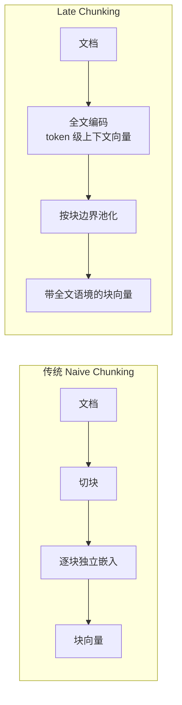

# RAG 项目数据加载与切片技术方案 · 技术分析文档

> 适用对象：RAG 系统设计与实现的工程师 / 架构师
> 文档性质：技术方案梳理与选型参考（不含完整可运行代码，仅以概念性片段说明关键参数）
> 配套背景：本工作区已落地 `spring-ai-milvus-demo` 与 `ai-chat-vue`（Vue3 + Spring Boot 全栈 RAG），本文结论可直接反哺其离线数据处理（索引构建）环节。

---

## 1. 背景与问题域

检索增强生成（RAG）的核心链路是：


业界普遍结论：**RAG 系统绝大多数失败不是因为 LLM 或向量库不行，而是因为切片（Chunking）这一"数据准备"环节设计不当**。切片直接决定了"模型被允许知道什么"——检索质量的上限在切片阶段就被锁死，再强的嵌入模型和向量库也无法挽回错误的切块。

因此，数据加载与切片不再是简单的 ETL 子任务，而是一个需要建模决策的环节：

- **加载**决定"喂进去的原始文本是否干净、结构是否保留、元数据是否完整"；
- **切片**决定"每一块能否独立承载一个语义单元，从而被准确嵌入与召回"。

本文系统梳理这两步的候选方案、适用场景、优缺点，并给出选型建议。

---

## 2. 数据加载技术方案

### 2.1 加载的本质：统一的 Document 抽象

无论来源如何，加载环节的目标是把异构数据归一化为一个标准对象：

| 字段 | 含义 | 对下游的影响 |
|------|------|--------------|
| `page_content` | 提取出的纯文本（或富文本片段） | 切片与嵌入的直接输入 |
| `metadata` | 来源、标题、章节、页码、时间、文档类型等 | 决定能否做**元数据过滤检索**、能否在生成时做溯源引用 |

> 关键认知：**metadata 不是可选项，而是检索质量的重要杠杆**。带章节/来源/类型的 chunk，可同时走"向量召回 + 元数据过滤 + 重排"，显著提升企业级 RAG 的精度与可审计性。

### 2.2 支持的文件格式与对应加载器（选型速查）

| 格式 | 典型加载器 / 工具 | 提取质量 | 结构保留 | 备注 |
|------|------------------|----------|----------|------|
| **TXT** | `TextLoader` | 高 | 无结构 | 朴素文本，仅可用，无语义信息 |
| **Markdown** | `UnstructuredMarkdownLoader` / `MarkdownHeaderTextSplitter` | 高 | **强**（标题层级天然） | **首选格式**，结构清晰易解析 |
| **HTML** | `UnstructuredHTMLLoader` / `BeautifulSoup` | 中（需清洗） | 中（DOM 标签丰富但含噪声） | 需剥离导航/广告/脚本等无关节点 |
| **PDF** | `PyPDFLoader` / `PyMuPDF` / `pdfplumber` / `Unstructured(PDF)` / `Adobe PDF Extract` | 低~中 | 弱（扫描件需 OCR） | **最棘手**：版面、表格、分页识别难，尽量经工具优化 |
| **DOCX** | `Docx2txtLoader` / `UnstructuredWordDocumentLoader` | 中~高 | 中（段落/标题可识别） | 企业内部资料常见 |
| **CSV / JSON** | `CSVLoader`（按行）/ `JSONLoader`（jq 路径提取） | 高（结构化） | 取决于字段设计 | 适合表格型、记录型知识 |
| **代码** | 语言专用解析器 / 正则按函数/类切分 | 高 | 强（语法结构） | 按"函数/类"为单元优于逐行 |
| **图片 / 扫描件** | OCR（Unstructured 图像 / 视觉模型） | 依赖 OCR 质量 | 弱 | 仅当无其他格式时兜底 |

**格式优先级经验法则**：`Markdown > HTML（经清洗） > PDF（无奈之选）`。若你能控制文档格式，优先产出 Markdown；网页来源走"HTML + DOM 清洗"；PDF 尽量先转 Markdown 或用 `unstructured` 做版面识别后再嵌入。

### 2.3 数据源接入方法

| 接入方式 | 说明 | 代表工具 / 协议 |
|----------|------|----------------|
| 本地文件 / 目录 | 单文件或批量目录递归加载 | `DirectoryLoader`（glob 匹配，多线程） |
| 网页 URL | 直接抓取并抽取正文 | `UnstructuredURLLoader`、爬虫、Readability |
| 关系型 / NoSQL 数据库 | 把查询结果当作文档 | JDBC / ORM + 自定义 Loader |
| 对象存储 | OSS / S3 上的文档桶 | SDK 列举 + 流式读取 |
| SaaS / 协作平台 | 企业知识源 | Confluence、Notion、GitHub、Wiki 加载器 |
| 消息 / 工单系统 | 对话、客服记录 | 各平台 API + 自定义解析 |

> 工程要点：接入层与切片层应**解耦**——Loader 只负责"产出标准化的 Document 列表"，切片与嵌入对来源无感。这样切换数据源（如从本地文件切到 OSS）只需替换 Loader，不影响下游。

### 2.4 加载质量的关键控制点

1. **结构保留**：标题层级、列表、表格、代码块要尽量作为结构化信息保留，而非压成一段纯文本——它们往往是切片与元数据过滤的依据。
2. **文本清洗**：去除页眉页脚、水印、重复导航、版式噪声；HTML 剥离 `<script>/<style>`。
3. **OCR 质量**：扫描版 PDF 必须靠 OCR，质量参差会直接污染切片内容。
4. **元数据注入**：在 Loader 阶段就补齐 `source / title / section / doc_type / timestamp`，为后续"元数据感知检索"打基础。

---

## 3. 文本切片（Chunking）技术方案

切片的核心参数有三个：

| 参数 | 含义 | 典型取值 |
|------|------|----------|
| `chunk_size` | 单块目标大小（token 或字符） | 通用 500~1000 tokens；技术文档 800~1500；法律/医疗 300~500 |
| `chunk_overlap` | 相邻块重叠量 | 建议 10%~20%（如 100~200 tokens） |
| 粒度 | 以"字符 / 句子 / 段落 / 章节 / 语义单元"为边界 | —— |

下面按"从朴素到智能"的演进层级，逐一分析。

### 3.1 固定长度切分（Fixed-Size）

按固定 token/字符数机械切分。

```text
# 概念性参数（以 LangChain 风格为例）
splitter = CharacterTextSplitter(chunk_size=500, chunk_overlap=50, separator="\n\n")
```

- **优点**：实现最简单、速度快、块大小可预测、零依赖。
- **缺点**：极易在句子/概念中间切断，破坏语义完整性。
- **适用**：原型验证、结构极弱的数据、延迟优先于精度的场景。

### 3.2 重叠切分（Overlapping）

在固定长度基础上，让相邻块保留一段重叠文本。

- **优点**：跨边界的上下文得以保留，是"固定长度"之上的安全升级基线。
- **缺点**：存储与嵌入成本上升（冗余），信息重复。
- **适用**：线性叙事文本、想低成本提升召回的场景。

### 3.3 按句子 / 段落切分（Sentence / Paragraph）

以完整句子或段落为最小单元再组合成块。

- **优点**：保证句子完整性，检索精度优于纯字符切分。
- **缺点**：句长不稳定，需句子边界检测；单句上下文可能不足。
- **适用**：自然语言文本（文章、邮件、文档问答）。

### 3.4 递归切分（Recursive Character Splitting）—— 业界默认基线

按一组分隔符的**优先级层次**递归切：`["\n\n", "\n", ". ", " ", ""]`。先尝试段落，块仍太大就落到句子、再词语、再字符。

```text
splitter = RecursiveCharacterTextSplitter(chunk_size=1000, chunk_overlap=200,
                                          separators=["\n\n", "\n", ". ", " ", ""])
```

- **优点**：最大程度贴合自然边界（段→句→词），通用性强，兼顾速度与效果。
- **缺点**：不保证语义内聚（一个段落里可能混了多个主题）；对无规律文本提升有限。
- **适用**：**几乎是一切 RAG 的起点基线**。无论何种文本，先上递归切分建立性能基准。

### 3.5 基于文档结构切分（Document-Structure Based）

利用文档固有结构切分——Markdown 标题层级、HTML 标签、代码函数/类、表格。

```text
splitter = MarkdownHeaderTextSplitter(headers_to_split=[
    ("#", "Header1"), ("##", "Header2"), ("###", "Header3")])
# 每个块自动携带 header 元数据
```

- **优点**：块边界与人类意图对齐，上下文逻辑强；标题天然成为 metadata，利于过滤。
- **缺点**：强依赖文档格式规范；章节长度不均时块大小失控。
- **适用**：技术手册、规范文档、Markdown/HTML/代码仓库等**结构清晰**的内容。

### 3.6 语义切分（Semantic Chunking）

用嵌入模型计算句间相似度，在"语义发生转折"处切分——把语义相近的句子聚成一个块。

```text
chunker = SemanticChunker(embeddings,
                          breakpoint_threshold_type="percentile",
                          breakpoint_threshold_amount=95)  # 相似度低于 95 分位即断点
```

- **优点**：块内概念高度内聚，检索精度高。
- **缺点**：需调用嵌入模型（成本/时延），块大小不均匀；需设最小块大小（100~150 tokens）防止碎片。
- **适用**：精度是瓶颈、文档长且主题自然过渡、可离线处理的场景。

### 3.7 小‑大切分（Small‑to‑Big / Parent Document）

检索用"小块"（精准命中），生成用"大块"（完整上下文）。同时维护两套索引，命中后回查父文档。

- **优点**：兼得"高精度召回"与"丰富生成上下文"，复杂问答效果突出。
- **缺点**：管道复杂，需管理父子两套索引与映射。
- **适用**：既要检索准、又要上下文完整的复杂问答。

### 3.8 层级切分（Hierarchical）

同一文档存多种粒度表示：高层摘要、中层章节、细粒度块，支持按查询意图多级检索。

- **优点**：支持探索式、混合高低层次的问题。
- **缺点**：存储与检索逻辑复杂。
- **适用**：大型知识库、混合抽象/细节的查询。

### 3.9 智能体 / LLM 切分（Agentic Chunking）

让 LLM 直接决定切分点，模拟人类理解文档结构与内容。

- **优点**：理论上效果最优，能处理表格/表单/图片等特殊块。
- **缺点**：成本高、慢、实验性，难以规模化。
- **适用**：小体量、高价值、对质量极度敏感的资料。

### 3.10 迟分（Late Chunking）—— 上下文感知的前沿方案

传统流程是"先切后嵌入"；迟分**反转顺序**：先用长上下文嵌入模型通读全文，得到每个 token 的上下文向量，再按块边界做平均池化。



- **原理价值**：块中"它/该公司/该方法"等指代，在编码时已见过前文，向量天然携带跨块上下文。Jina AI 实测在 BEIR 上 nDCG@10 普遍提升（NFCorpus +6.5pp）。
- **前提**：嵌入模型需支持长上下文（≥8192 tokens，如 `jina-embeddings-v2`、`nomic-embed-text-v1.5`、`modernbert-embed`）。
- **优点**：召回质量接近 LLM 上下文增强，但索引速度快约 120 倍、成本极低。
- **缺点**：依赖长上下文嵌入模型；超长文档需回退或分层。
- **适用**：含跨块指代/叙述性长文档、查询跨越章节的"多跳"问题。

### 3.11 混合切分（Hybrid）

组合多种策略，例如"先按 Markdown 标题宏观切，再对过长块用递归切二次细分"。

- **优点**：平衡效率与质量，应对结构复杂、密度不均的文档最实用。
- **缺点**：实现逻辑更复杂，需两步处理与边界管理。
- **适用**：混合多种格式、内容密度不均的复杂知识库（企业级常见）。

---

## 4. 对比分析与粒度影响

### 4.1 各切片策略对比总表

| 策略 | 检索质量 | 速度 | 成本 | 块大小可控 | 最佳适用 |
|------|----------|------|------|------------|----------|
| 固定长度 | 低 | 极快 | 免费 | 强 | 原型、弱结构数据 |
| 重叠切分 | 中低 | 快 | 低（冗余） | 强 | 线性文本的安全基线 |
| 句子/段落 | 中 | 快 | 免费 | 弱 | 自然语言文本 |
| 递归切分 | 中~良 | 快 | 免费 | 中 | **通用默认基线** |
| 结构切分 | 高 | 快 | 免费 | 弱 | 结构化文档(MD/HTML/代码) |
| 语义切分 | 高 | 中 | 嵌入成本 | 弱(不均) | 精度瓶颈、长文 |
| 小‑大切分 | 很高 | 中 | 双索引 | 中 | 复杂问答 |
| 层级切分 | 很高 | 中 | 高(多表示) | 中 | 大型混合知识库 |
| 智能体切分 | 极高 | 慢 | LLM成本 | 中 | 小体量高价值 |
| 迟分 | 高(长文更优) | 中 | 低 | 中 | 跨块指代/多跳 |
| 混合切分 | 很高 | 中 | 中 | 中 | 企业复杂文档 |

> 共性结论：**不存在银弹**。高质量 RAG 往往同时采用多种策略 + 重排（rerank）+ 查询感知检索。检索一旦"感觉不对"，先修切片，别急着换模型。

### 4.2 切片粒度对检索效果的影响

粒度（块大小）是在"细节"与"整体"之间做权衡，直接影响信噪比：

- **块过大（如 >1500 tokens）**
  - 嵌入向量过于笼统（稀疏），多个主题被压进一个向量，召回时"答非所问"的噪声增大；
  - 超出嵌入模型/LLM 窗口时被迫截断；
  - 单块塞进 LLM 会稀释真正相关的信息，加剧幻觉。
- **块过小（如 <200 tokens）**
  - 语义被切断，指代消解失败（"它"不知指谁）；
  - 检索结果碎片化，单块信息不足以独立回答一个问题；
  - 嵌入区分度下降（信息太少，向量无判别力）。
- **overlap 的作用**：在不增大单块的前提下，让边界信息在相邻块重复出现，缓解"跨边界语义断裂"，是低成本提效的关键旋钮。
- **按数据类型调粒度**（经验区间）：
  - 通用文本：500~1000 tokens，overlap 10%~20%
  - 技术文档：800~1500 tokens，按章节
  - 法律/医疗：300~500 tokens（精度优先）
  - 代码：以函数/类为单位（结构切分）
  - 对话/问答：以单轮对话为单位

> 一个好块的判据：**理想情况下，单个块能独立回答一个相关问题**。这正是语义切分、结构切分力求达到的目标。

### 4.3 加载质量如何传导到检索

加载不干净，切片再好也救不回：

- PDF 错乱的版面 → 块内混入页眉/断行 → 嵌入噪声；
- 丢失标题层级 → 无法结构切分、无章节元数据 → 只能退化为递归切分，且无法做元数据过滤；
- OCR 错误 → 切片内容本身就是错的，召回与生成全错。

**因此加载与切片应作为一体来设计**：先用高质量 Loader 保结构与元数据，再据文档类型选切片策略。

---

## 5. 选型建议

### 5.1 分层决策框架（从基线到复合）

```
第 1 步：默认上 递归切分（RecursiveCharacterTextSplitter）
        → 建立性能基线，通用、免费、稳健。
第 2 步：检查结构特征
        → 若有清晰结构（MD 标题/HTML/代码），切到 结构感知切分，
          低成本高收益。
第 3 步：精度成为瓶颈时
        → 引入 语义切分 或 小‑大切分（既要精准又要完整上下文）。
第 4 步：文档极端复杂（多格式/密度不均）
        → 上 混合切分（宏观结构切 + 微观递归细分）。
全程可叠加：迟分（长上下文模型）、元数据过滤、重排（rerank）。
```

### 5.2 按文档类型选型表

| 文档类型 | 推荐加载器 | 推荐切片策略 |
|----------|-----------|--------------|
| 技术博客 / 说明文档 / 知识库 | Markdown Loader | 结构切分（标题）+ 递归兜底 |
| 网页 | HTML Loader + DOM 清洗 | 递归切分 / 结构切分 |
| PDF（电子版） | `pdfplumber` / `unstructured` | 递归切分；含表格走结构识别 |
| PDF（扫描件） | OCR + `unstructured` | 递归切分（先保 OCR 质量） |
| 企业 Word 资料 | `Docx2txtLoader` | 段落/递归切分 |
| 代码仓库 | 语言解析器 | 函数/类级结构切分 |
| 表格 / 记录（CSV/JSON） | `CSVLoader` / `JSONLoader` | 按行/记录为单元 |
| 长叙事 / 多跳问答 | 任意干净 Loader | 迟分 / 语义切分 |
| 混合复杂企业文档 | 多 Loader 组合 | 混合切分 |

### 5.3 按查询类型选型

- **事实型短问答**（"XX 是什么"）→ 递归/结构切分 + 小块即可。
- **跨章节多跳问答**（"A 与 B 的关系"）→ 迟分 / 小‑大切分，保上下文连贯。
- **高精度专业检索**（法律/医疗）→ 小粒度 + 重排 + 元数据过滤。
- **探索式宽泛查询** → 层级切分（摘要+细节）。

### 5.4 工程落地与评估

1. **先建基线再迭代**：永远从递归切分起步，用同一评估集对比其他方法，避免过早复杂化。
2. **评估指标**：用检索侧指标（Recall@k、nDCG@10、MRR）和端到端回答质量（人工或 LLM-as-judge）闭环验证切片改动。
3. **可观测**：在 metadata 中记录 `chunk_strategy / chunk_size / source`，便于 A/B 对比。
4. **与向量库协同**：本文的 `chunk → embedding → Milvus` 链路，在 `spring-ai-milvus-demo` 中即可直接落地——Loader/Chunker 在离线索引阶段运行，Milvus 负责存储与相似检索，Spring AI 负责编排。切片策略的 `chunk_size`/`overlap` 应与所选嵌入模型的 `max_tokens` 对齐。

---

## 6. 小结

- **加载**决定输入质量：优先 Markdown，保结构与元数据，解耦数据源与下游。
- **切片**是 RAG 的真正瓶颈：从递归切分起步，按文档结构与查询需求逐步升级到语义/迟分/混合。
- **粒度**本质是信噪比权衡：块太大笼统、太小断裂，overlap 是低成本提效旋钮。
- **没有银弹**：生产级 RAG 通常是"多策略 + 元数据过滤 + 重排"的组合，并以检索指标驱动迭代。

> 本文结论可直接应用于本工作区 RAG 项目的离线索引环节：替换 Loader 提升加载质量、按文档类型切换 Chunker、并把 `chunk_size/overlap` 与嵌入模型窗口对齐，是性价比最高的第一轮优化。

---

## 7. 落地改造清单：ai-chat-vue RAG 项目（rag.js 具体改造）

本节把前面的方案落到你已有的 `实战_复刻ai-chat-vue/src/rag.js`。先盘点现状，再给按优先级排列的改造项与可直接套用的代码。

### 7.1 现状盘点（基于实际 rag.js）

| 维度 | 当前实现 | 问题 |
|------|----------|------|
| 切片函数 | `chunkText(text, size=300, overlap=50)` | **朴素固定长度字符切分**，没有任何分隔符/结构感知，可能在句子、乃至词语中间切断 |
| chunk_size | 300 字符（≈150~200 tokens，中文） | 对中文偏小，一个段落常被切成两半，易语义断裂 |
| 嵌入模型 | `BAAI/bge-m3`（经 `/api/embed` 转发，Key 在后端） | 上限 **8192 tokens**；但 API **只返回句级汇总向量**，不返回 token 级向量 |
| 检索 | 浏览器内 `cosine` 相似度，`topK=3` | **无相似度阈值**，低相似度片段也会被塞进 prompt，易答非所问 |
| 块结构 | `{ text, vector }` | **无 metadata**（来源/序号），无法做过滤、溯源、A/B |

### 7.2 改造清单（按优先级）

#### P0 — 切分器升级 + 粒度校准（必做，零依赖、纯前端）

- **换掉朴素固定切分，改用"分隔符感知的递归切分"**：先在 `rag.js` 里实现一个小程序化的递归切分器（见 7.3），优先按 `段落(\n\n) → 换行(\n) → 句号(。) → 逗号(，) → 字符` 的层级切，尽量保留语义边界；只有当单个自然片段仍超长时才退化到定长。
- **chunk_size 上调到 450 字符、overlap 调到 60 字符**（中文经验值，约 250~350 tokens）。理由：300 偏小吃不下一个完整段落；450 既能装下多数中文段落、又远在 bge-m3 的 8192 token 上限内，overlap≈13% 可缓解边界断裂。技术文档/代码可再放到 500~800 字符（按逻辑块）。
- 配套：**给每个 chunk 加 metadata** `{ text, vector, metadata:{ index, charStart, source } }`，为后续过滤/溯源打底（即使现在不用，也别再丢掉）。

#### P0 — 检索加"相似度阈值"（必做，一行代码）

- `retrieve` 里加 `threshold`（建议 `0.3` 起）过滤：`score < 阈值` 的片段直接丢弃，避免"资料里没有"还硬塞。
- `topK` 从 3 调到 **4~5**：块变小后每段信息更碎，多取几条更稳；配合阈值不会引入噪声。

#### P1 — 嵌入批量与超限保护

- `embed(texts)` 一次把整本文档的所有 chunk 发给 SiliconFlow。bge-m3 单次请求有 token 上限，文档很大时要**分批（如每批 ≤ 32 段）**并加失败重试，否则大文档会整批失败。
- 校验单段 ≤ 8192 tokens（450 字符远小于此，正常无虞，但用户粘贴超长无标点文本时要兜底）。

#### P2 — 语义切分（精度瓶颈时再做）

- 思路：先按句切，逐句调 `embed` 算向量，相邻句余弦低于某断点（如 0.85）就切。需**额外嵌入调用（成本/时延）**，且当前浏览器端逐个 fetch 较慢。
- 建议：先把 P0 跑出基线，用检索指标对比，确认"递归切分不够"再上语义切分；可改为后端批量算句向量再回传，避免前端逐个请求。

#### P2 — 结构切分（若知识资料是 Markdown）

- 若你的知识库文档是 Markdown，可在 `chunkText` 之前先按 `#/##/###` 切出章节，并把标题写进 `metadata.header`，检索时既能结构召回也能过滤。成本极低、收益明显。

#### ⚠️ 明确排除：迟分（Late Chunking）在本架构暂不可行

- 第 3.10 节讲的迟分需要"先通读全文得到 **token 级** 向量，再按块池化"。但你用的 `BAAI/bge-m3` 经 SiliconFlow 只返回**句级汇总向量**，拿不到 token 级输出；且前端逐文档全量嵌入既超 8192 token 上限又贵。
- **结论**：在你的 `ai-chat-vue` 当前架构下，不要上迟分。等后端改成自托管 bge-m3 并开放 token 级输出、或换用原生支持迟分的模型（如 jina/nomic/modernbert-embed）时再考虑。届时切分逻辑应前置到 **后端索引阶段**，而不是 `rag.js` 前端。

### 7.3 可直接套用的 rag.js 代码（替换原函数）

**① 递归感知切分器（替换原 `chunkText`）**

```js
// 分隔符优先级（从高到低）：先按段落/换行/标点切，仍超长再退化到字符
const SEPARATORS = ['\n\n', '\n', '。', '！', '？', '，', '']

export function chunkText(text, size = 450, overlap = 60) {
  const clean = text.replace(/\s+/g, ' ').trim()
  if (!clean) return []

  // 第一遍：按分隔符切成"自然片段"
  let parts = [clean]
  for (const sep of SEPARATORS.slice(0, -1)) {
    const grown = []
    for (const p of parts) {
      if (p.length <= size) { grown.push(p); continue }
      for (const piece of p.split(sep)) {
        if (piece.trim()) grown.push(piece.trim() + (sep === ' ' ? '' : sep))
      }
    }
    parts = grown
  }

  // 第二遍：贪心拼成 <=size 的块，块尾重叠 overlap；单片段仍超长则定长兜底
  const chunks = []
  let buf = ''
  for (const p of parts) {
    if ((buf + p).length <= size) {
      buf += p
    } else {
      if (buf) chunks.push(buf)
      if (p.length > size) {
        for (let i = 0; i < p.length; i += size - overlap) {
          chunks.push(p.slice(i, i + size))
        }
        buf = ''
      } else {
        buf = p
      }
    }
  }
  if (buf) chunks.push(buf)
  return chunks.filter(c => c.trim())
}
```

**② 带阈值与 metadata 的检索（替换原 `retrieve` / 建库处补 metadata）**

```js
// 建库时给每段补 metadata（source 可传文件名/文档名）
// knowledgeChunks 形如 [{ text, vector, metadata:{ index, source } }]

export async function retrieve(knowledgeChunks, query, topK = 4, threshold = 0.3) {
  if (knowledgeChunks.length === 0) return []
  const [queryVec] = await embed([query])
  const scored = knowledgeChunks
    .map(kc => ({ text: kc.text, meta: kc.metadata, score: cosine(queryVec, kc.vector) }))
    .filter(s => s.score >= threshold)          // 丢弃低相似度，避免答非所问
    .sort((a, b) => b.score - a.score)
  return scored.slice(0, topK).map(s => s.text)
}
```

**③ 嵌入分批（替换/补充原 `embed` 调用处）**

```js
// 大文档分批嵌入，避免单次请求超 token 上限
export async function embedBatch(texts, batchSize = 32) {
  const out = []
  for (let i = 0; i < texts.length; i += batchSize) {
    const batch = texts.slice(i, i + batchSize)
    const vecs = await embed(batch)   // 复用现有 /api/embed
    out.push(...vecs)
  }
  return out
}
```

### 7.4 落地步骤与验证

1. 把 7.3 的 `chunkText` / `retrieve` 替换进 `rag.js`，`chunk_size=450`、`overlap=60`、`topK=4`、`threshold=0.3`。
2. 建库代码补 `metadata:{ index, source }`（source 取自上传文件名）。
3. 大文档走 `embedBatch` 分批。
4. 用同一组"问题→期望片段"做前后对比：重点看（a）是否还会切在句子中间；（b）无关问题是否返回空（阈值生效）；（c）回答是否更准。
5. 若仍不满意，再按 7.2 的 P2 上语义切分 / 结构切分，继续用同一评估集迭代。

> 一句话：**先把 `chunkText` 从"定长字符"换成"递归感知切分"并把 size 调到 450，再给 `retrieve` 加个 0.3 阈值——这两步零依赖、改动最小，却是这个项目性价比最高的一轮优化。**
