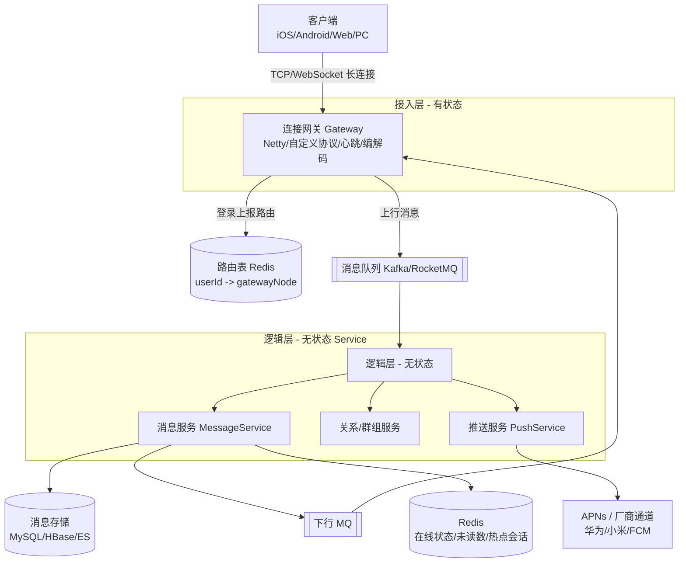
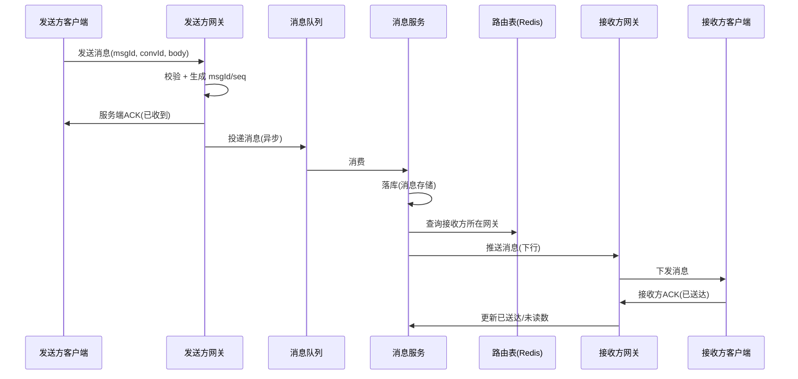

# IM 即时通讯系统设计与实现技术方案

> 文档定位：面向具备一定后端开发基础的工程师，系统阐述如何设计与实现一个生产级 IM（Instant Messaging，即时通讯）系统。
> 阅读完本文，你将能回答三个问题：**难在哪、怎么设计、Java 怎么落地**。

---

## 目录

1. [IM 系统概述](#1-im-系统概述)
2. [设计 IM 系统面临的最大难点](#2-设计-im-系统面临的最大难点)
3. [整体设计思路与实现路径](#3-整体设计思路与实现路径)
4. [可行的技术方案与业界成熟方案](#4-可行的技术方案与业界成熟方案)
5. [Java 技术栈的具体实现](#5-java-技术栈的具体实现)
6. [端到端可靠性设计（核心难点落地）](#6-端到端可靠性设计核心难点落地)
7. [性能、扩展性与高可用](#7-性能扩展性与高可用)
8. [安全与合规](#8-安全与合规)
9. [总结与学习路径](#9-总结与学习路径)
10. [附录：参考方案与项目索引](#10-附录参考方案与项目索引)

---

## 1. IM 系统概述

### 1.1 什么是 IM 系统

IM（Instant Messaging）系统是一类以**实时消息投递**为核心能力的通信系统，典型产品包括微信、WhatsApp、Slack、钉钉、Discord 等。与普通的 Request/Response 业务系统不同，IM 的核心特征是：

- **长连接**：客户端与服务端维持一条长期存活的双向通道（而非每次请求建连）。
- **服务端主动推送**：消息可以由服务端在任意时刻主动下发给客户端。
- **极低的端到端延迟**：消息从发送到对方收到通常在百毫秒级。
- **海量并发连接**：单一系统常需承载百万乃至千万级在线连接。

### 1.2 典型场景与规模

| 场景 | 特征 | 典型要求 |
|------|------|----------|
| 社交 IM（微信类） | 单聊、群聊、朋友圈 | 超大群、海量连接、消息必达 |
| 企业协同（钉钉/Slack） | 组织关系、机器人、文件 | 强权限、审计、搜索 |
| 客服/营销 | 高并发咨询、自动回复 | 高吞吐、内容安全 |
| 直播/语聊（Discord） | 聊天室、大群广播 | 写扩散、低延迟广播 |
| IoT 设备消息 | 弱网、低功耗 | MQTT、轻量协议 |

一个中等规模的 IM 系统，日消息量可达数十亿条；头部产品日消息量以千亿计。规模本身会放大每一个工程难题。

---

## 2. 设计 IM 系统面临的最大难点

很多人以为 IM 的难点是"聊天界面"或"协议格式"，其实那只是冰山一角。**IM 真正的难点，是在「海量有状态长连接」之上，同时满足「实时性、可靠性、有序性、可水平扩展、高可用」这一组相互制约的目标。** 我们把它拆解为以下核心挑战，并标注其中最致命的一条。

### 2.1 ★ 最大难点：有状态长连接之上的「实时 + 可靠 + 有序」投递

普通 Web 服务是无状态的（每个请求独立、可由任意节点处理），IM 则不同：**一条连接本身是有状态的**，且消息必须沿着"对的连接"准确送达。当你要同时保证下面三件事时，复杂度会指数级上升：

- **实时**：消息产生后尽快送达，不能靠轮询。
- **可靠（不丢、不重、不乱序）**：网络抖动、进程重启、客户端崩溃都不能丢消息；重试不能产生重复；群聊里 A 先发 B 后发，所有人看到的顺序必须一致。
- **可扩展**：连接数从 1 万涨到 100 万时，系统能通过加机器线性扩容，且扩容/缩容不能丢连接、不能乱序。

这三点构成一个"不可能三角"式的张力：为了可靠你要落库和确认，为了实时你要少落库少等待，为了扩展你要让连接无感知地漂移到不同节点——**如何在这三者间取得工程平衡，是 IM 设计的核心命题**。后续第 3、5、6 节都是围绕它展开。

### 2.2 海量长连接的管理（C10M 问题）

单机需要稳定维持 **十万~百万级 TCP 连接**。这会带来一系列底层挑战：

- **文件描述符与内存**：每个连接占一个 fd 和内核缓冲区；100 万连接 × 几 KB ≈ 数 GB 内存，需精细控制。
- **心跳与存活检测**：要快速发现死连接并回收资源，又不能心跳过频浪费带宽。
- **连接迁移**：网关扩缩容、宕机时，百万连接如何优雅重连、且不重复登录、不丢在途消息。
- **CPU 调度**：海量连接的读写事件需要高效的 I/O 多路复用（epoll/kqueue），不能"一个连接一个线程"。

### 2.3 消息时序与多端一致性

- 分布式环境下**没有全局一致时钟**，毫秒级时间差就会导致乱序。
- 同一用户在手机、PC、平板多端登录，消息历史、未读数、已读状态必须**多端同步**（消息漫游）。
- 群聊消息需要保证所有成员看到的顺序一致（全局有序 vs 会话有序的取舍）。

### 2.4 弱网与移动端推送

- 移动网络频繁切换（4G/WiFi 切换、进入电梯/地铁），连接极易中断。
- App 被系统杀掉或后台受限时，**长连接不可用**，必须有"保底通道"把消息送达到端（厂商推送通道）。
- 长连接的"保活"与系统省电策略天然冲突，需要精细的心跳与重连策略。

### 2.5 水平扩展与服务发现

- 长连接是有状态的，传统四层/七层负载均衡无法简单"随便转发"，否则用户第二次请求落到另一台机器就找不到连接了。
- 需要一套**连接路由表**（用户 → 所在网关节点），且这张表本身要高性能、可水平扩展。

### 2.6 高可用与容灾

- 任何单点故障都不能导致消息丢失或服务不可用。
- 跨机房、跨地域（异地多活）下，消息需要不丢、不重、不乱序地复制。

---

## 3. 整体设计思路与实现路径

### 3.1 设计原则

| 原则 | 说明 |
|------|------|
| **接入与逻辑分离** | 长连接网关只管"连接 + 收发字节"，不含业务逻辑；业务逻辑放在无状态的服务层，便于各自扩缩容。 |
| **网关有状态，逻辑无状态** | 网关维护连接（有状态）；消息路由、落库、关系链等服务做成无状态，可随意水平扩展。 |
| **推送与拉取结合** | 在线时服务端主动 Push；离线/新设备通过 Pull（拉历史 + 拉离线）补齐。 |
| **异步解耦** | 消息收发链路用消息队列削峰、解耦、做可靠投递与扇出。 |
| **一切皆可水平扩展** | 网关、逻辑、存储、缓存都不能有单点瓶颈。 |

### 3.2 分层架构

下面是一套生产级 IM 的典型分层（mermaid 架构图）：



### 3.3 核心概念模型

| 概念 | 说明 |
|------|------|
| **User** | 用户，含唯一 userId。 |
| **Device / Connection** | 一个登录设备 = 一条长连接；用户可多端登录。 |
| **Session / Conversation** | 会话（单聊 = 两人，群聊 = 多人的集合）。 |
| **Message** | 消息实体：msgId（全局唯一）、convId、sender、receiver、timestamp、seq（会话内序号）、body、type。 |
| **Route Table** | `userId -> gatewayNodeId + channelId`，用于找到用户当前连接。 |

### 3.4 消息收发主流程（以单聊为例）



要点：**发送方 ACK** 与 **接收方 ACK** 分离，服务端落库与推送解耦，保证任何一环失败都可重试而不丢消息。

### 3.5 关键技术选型决策

**(1) 实时通道怎么选？**

| 方案 | 优点 | 缺点 | 适用 |
|------|------|------|------|
| HTTP 短轮询 | 简单 | 延迟高、浪费资源 | 不推荐 |
| HTTP 长轮询（Long Polling） | 兼容好 | 连接频繁重建 | 过渡/兼容性场景 |
| WebSocket | 标准、浏览器原生、全双工 | 需自己处理心跳/重连 | Web/小程序主流 |
| 私有 TCP 二进制协议 | 极致性能、可控 | 开发成本高 | 自研 App（微信类） |

主流自研做法：**App 走私有 TCP/WebSocket + Protobuf 二进制协议；Web 走 WebSocket**。

**(2) 群消息：写扩散 vs 读扩散？**

- **写扩散（Feed 模式）**：发一条群消息，给每个群成员写一条收件箱记录。读快、写重，适合小群。
- **读扩散（读时聚合）**：只存一份群消息，成员读取时再聚合。写轻、读重，适合大群/超大群。
- 实际系统常**混合**：小群写扩散，大群（如 500 人以上）切读扩散 + 最新消息缓存。

**(3) 消息时序方案**

放弃"全局精确时钟"，改用 **递增序列号**：
- 会话内序号 `seq`：每会话一个单调递增计数器（Redis `INCR` 或 Snowflake 改型），保证会话内严格有序。
- 全局 `msgId`：用 Snowflake 之类分布式 ID 保证唯一，用于去重与检索。

### 3.6 实现路径（演进路线）

建议按以下阶段迭代，避免一上来就追求"微信级"架构：

| 阶段 | 目标 | 关键动作 |
|------|------|----------|
| **MVP** | 跑通收发 | 单机 Netty 网关 + 内存转发，单聊可用 |
| **P2** | 解耦与可靠 | 引入 MQ 解耦收发，消息落库，引入 ACK |
| **P3** | 水平扩展 | 网关集群化，Redis 路由表，逻辑层无状态化 |
| **P4** | 离线 & 推送 | 离线消息存储 + 厂商通道推送，多端同步 |
| **P5** | 生产可用 | 高可用部署、监控告警、安全合规、压测 |

---

## 4. 可行的技术方案与业界成熟方案

### 4.1 通信协议选型

| 协议 | 定位 | 特点 | 评价 |
|------|------|------|------|
| **XMPP** | 老牌开放式 IM 协议 | 基于 XML、扩展性强、生态老 | 冗余大、移动端偏重，新项目少选 |
| **MQTT** | IoT 物联网 | 极轻量、Pub/Sub、长连接保活好 | 适合设备消息，社交 IM 功能需自建 |
| **WebSocket + 自定义** | 自研主流 | 全双工、可自定义二进制帧 | 灵活，需自己设计协议与心跳 |
| **私有 TCP 二进制** | 巨型 IM | 极致性能、带宽最小 | 工程量大，需自研全套 |

**建议**：学习/中小项目用 **WebSocket + Protobuf**；追求极致性能再上私有 TCP。协议帧通用结构：`[长度][版本][命令字][序列号][body]`，并用 `LengthFieldBasedFrameDecoder` 解决粘包拆包。

### 4.2 开源方案对比

| 项目 | 语言/技术栈 | 特点 | 适用 |
|------|------|------|------|
| **OpenIM** | Go + Flutter | 高并发、云原生、内置音视频、全平台 | 产品内嵌 IM、社交/企业协作 |
| **Rocket.Chat** | Node.js + MongoDB | 开源 Slack 替代品、插件生态强 | 团队协作、客服 |
| **Mattermost** | Go + React | 企业级安全、与 GitLab 集成 | 研发团队协作 |
| **Matrix / Element** | Python + React（联邦协议） | 去中心化、跨服互通、E2E 加密 | 隐私/跨组织通讯 |
| **CIM** | Java | 轻量 Java IM 框架，学习友好 | 学习、中小项目 |
| **MobileIMSDK** | Java | 专为移动端 IM 的 SDK | 移动端快速集成 |
| **TeamTalk** | C++/Java | 经典开源 IM（蘑菇街开源） | 学习架构 |
| **盒子 IM / V-IM** | Java/前端 | 仿主流聊天 UI、上手快 | 快速原型 |
| **Tigase / ejabberd** | Java / Erlang（XMPP） | 老牌 XMPP 服务器，稳定 | XMPP 体系 |

> 选型提示：若团队以 **Java** 为主、想读源码学习，优先看 **CIM / MobileIMSDK / 盒子 IM**；若要生产级开箱即用，优先 **OpenIM**（虽是 Go，但部署简单、性能强）。

### 4.3 商用 / 云服务方案（国内为主）

| 厂商 | 核心优势 | 典型场景 |
|------|----------|----------|
| **腾讯云 IM** | 微信/QQ 同源技术、生态全、超大群、全球加速 | 社交、直播、客服 |
| **网易云信** | 弱网稳定、圈组（超大社区）、融合 RTC | 社区、游戏、在线教育 |
| **融云 (RongCloud)** | 消息"不丢不重不乱序"、全球化、弱网优化 | 出海、社交、IoT |
| **环信 (Easemob)** | 客服场景强、移动客服云成熟 | App 内客服、电商导购 |
| **声网 / 即构** | RTC 音视频为核心、IM 作补充 | 音视频互动场景 |
| **蓝莺 IM** | 云原生、多云、可集成大模型 | 智能聊天 |
| **Sendbird / PubNub** | 国际化、Chat UIKit、全球 Data Stream | 海外产品 |

> 商用方案通常按 **DAU / 消息量 / 峰值连接** 计费，能省去自研长连接与推送的巨量工程，但存在**数据出域、厂商绑定、长期成本**的权衡。

### 4.4 自研 vs 采购决策

```
是否需要完全掌控数据与协议？
├─ 否 → 直接采购云服务（腾讯云 IM / 融云 / 环信），最快上线
└─ 是 → 是否团队有 C10M 长连接经验？
        ├─ 否 → 基于开源（OpenIM / Rocket.Chat）二次开发
        └─ 是 → 自研（参考本文架构 + Java/Netty 落地）
```

---

## 5. Java 技术栈的具体实现

本节是面向 Java 工程师的落地指南，覆盖网络通信、并发、MQ、存储、推送五大核心，并给出关键技术点与示例。

### 5.1 网络通信：Netty 是基石

Java 做长连接网关几乎必选 **Netty**（基于 NIO 的异步事件驱动框架），它封装了 epoll/kqueue，让你用 Reactor 模型轻松支撑百万连接。

**核心知识点：**

- **Reactor 模型**：`bossGroup`（Acceptor，接收连接）+ `workerGroup`（I/O 读写）。
- **ChannelPipeline / ChannelHandler**：入站/出站处理器链，做编解码、心跳、业务分发。
- **心跳**：`IdleStateHandler` 检测读/写空闲，超时则关闭连接。
- **粘包拆包**：`LengthFieldBasedFrameDecoder` 按长度字段切分。
- **编解码**：用 Protobuf（高效二进制）或自定义 `ByteToMessageDecoder`。
- **连接管理**：用 `ChannelGroup` / `ConcurrentHashMap<userId, Channel>` 维护在线连接。

**最小网关骨架示例：**

```java
public class ImServer {
    public void start(int port) throws Exception {
        EventLoopGroup boss = new NioEventLoopGroup(1);
        EventLoopGroup worker = new NioEventLoopGroup(); // 默认 CPU*2
        try {
            ServerBootstrap b = new ServerBootstrap();
            b.group(boss, worker)
             .channel(NioServerSocketChannel.class)
             .childHandler(new ChannelInitializer<SocketChannel>() {
                 @Override
                 protected void initChannel(SocketChannel ch) {
                     ChannelPipeline p = ch.pipeline();
                     // 1) 解决粘包拆包：长度字段在前 4 字节
                     p.addLast(new LengthFieldBasedFrameDecoder(1024 * 1024, 0, 4, 0, 4));
                     p.addLast(new ProtobufDecoder(ImMsg.Message.getDefaultInstance()));
                     // 2) 心跳：读空闲 60s 触发
                     p.addLast(new IdleStateHandler(60, 0, 0));
                     p.addLast(new HeartbeatHandler());
                     // 3) 业务分发
                     p.addLast(new MessageRouteHandler());
                 }
             });
            b.bind(port).sync().channel().closeFuture().await();
        } finally {
            boss.shutdownGracefully();
            worker.shutdownGracefully();
        }
    }
}
```

> 踩坑提示：**绝对不要在 `ChannelHandler` 里做阻塞操作（DB、同步 RPC）**，否则会卡死整个 EventLoop 线程，拖垮所有连接。耗时操作必须提交到独立业务线程池，或投递到 MQ 异步处理。

### 5.2 并发编程：让 EventLoop 不被阻塞

- **Reactor 线程不被阻塞**是铁律；业务处理走独立 `ThreadPoolExecutor`。
- **无锁化计数**：消息序号、未读数用 `AtomicLong` / `LongAdder`，避免锁竞争。
- **序列号生成**：会话内 seq 用 Redis `INCR`，或 Snowflake 生成全局唯一 msgId。
- **CompletableFuture** 编排异步链路（如落库 + 推送并行）。
- **线程池隔离**：连接管理、消息落库、推送各用独立线程池，避免一类慢任务拖垮全局。

### 5.3 消息队列：Kafka / RocketMQ

MQ 在 IM 中承担三件大事：

1. **削峰填谷**：突发群发消息先入队，后端按能力消费。
2. **解耦**：网关只管收，消息服务异步消费处理（落库、路由、推送）。
3. **扇出（写扩散）**：一条群消息 → 扇出成 N 条成员收件箱写入。

**可靠性要点：**

- 用 **RocketMQ 事务消息** 或 **本地消息表** 保证"业务落库"与"消息投递"最终一致。
- 消费端必须**幂等**（按 msgId 去重），因为 MQ 可能重复投递。
- 死信队列兜底处理多次失败的消息。

### 5.4 存储设计

IM 的数据分三类，存储策略差异很大：

| 数据 | 存储 | 说明 |
|------|------|------|
| 用户/好友/群组关系 | **MySQL** | 结构化、强一致，常规 CRUD |
| 消息内容 | **MySQL（热）+ HBase/ES（冷/归档）** | 近期消息落 MySQL 便于查询，历史归档到 HBase，全文检索走 ES |
| 在线状态 / 路由表 / 未读数 / 热点会话 | **Redis** | 高性能 KV，路由表 `userId -> nodeId` |
| 离线消息 | Redis（短期）+ MySQL（持久） | 用户上线后 Pull 补齐 |

**关键设计：**

- **路由表**是长连接扩展的核心：`HSET route:userId gatewayNode channelId`，推送前先查路由找到目标网关。
- **未读数**用 Redis 计数，避免每次打开会话都扫库。
- **消息分库分表**：按 `convId` 或 `userId` 哈希分片，避免单表过大。

### 5.5 推送：长连接 + 厂商通道双保险

在线时走长连接 Push；**App 被杀/后台受限时走系统推送通道**：

- **iOS**：**APNs**（Apple Push Notification service），必须走苹果服务器，无法绕过。
- **Android 国内**：各厂商通道——**华为 / 小米 / OPPO / vivo / 荣耀 / 魅族**，因为国内 GCM/FCM 不可达，且第三方 App 后台常被杀，必须集成厂商通道。
- **海外 Android**：**FCM**。
- **推送策略**：用户在线 → 直接长连接下发；离线/不在线 → 调用厂商通道推送一条"你有新消息"的提醒，用户点开 App 后通过长连接 Pull 完整消息。

**保活与重连：**

- 心跳间隔权衡：太短耗电，太长丢连接。移动网络常取 **30~60s 读空闲检测 + 4~5min 应用层心跳**。
- 网络切换（WiFi⇄4G）立即触发重连，并携带 `lastSeq` 让服务端补齐丢失消息。

### 5.6 服务治理与工程化

- **Spring Boot / Spring Cloud** 构建无状态逻辑服务。
- **注册中心**（Nacos / Consul / Eureka）做服务发现，网关上报自身节点信息。
- **API 网关**（Spring Cloud Gateway）处理登录鉴权、限流。
- **容器化 + K8s**：网关与逻辑服务各自弹性扩缩。
- **可观测性**：Prometheus + Grafana（连接数、消息 QPS、推送延迟、离线率），链路追踪（OpenTelemetry）。

### 5.7 Java 侧可靠性要点

- **三层 ACK**：发送方→服务端（确认收到）、服务端→接收方（确认投递）、接收方→服务端（已读）。
- **消息去重**：`msgId` 全局唯一；消费端用 Redis `SET` 或布隆过滤器判重。
- **重试与死信**：投递失败指数退避重试，超限进死信人工/定时补偿。
- **幂等消费**：MQ 消费逻辑以 `msgId` 做唯一约束，重复消息直接跳过。

### 5.8 安全

- **传输加密**：全链路 TLS（wss / 私有协议上 TLS）。
- **鉴权**：连接建立后先走登录鉴权（JWT / OAuth2 Token），未授权立即断连。
- **内容安全**：接入文本/图片/语音审核（如腾讯云内容安全），防违规。
- **端到端加密（E2E）**：高安全场景用 Signal 协议的 Double Ratchet（Olm/Megolm，参考 Matrix）。

---

## 6. 端到端可靠性设计（核心难点落地）

把第 2.1 节的最大难点落到可执行的机制上：

### 6.1 三层确认机制

```
发送方 ──(1)已发ACK──▶ 服务端（落库 + 路由）
服务端 ──(2)已投ACK──▶ 接收方（端上展示）
接收方 ──(3)已读ACK──▶ 服务端（更新已读/未读）
```

- 任一层未收到 ACK → 超时重传（发送方本地缓存未确认消息）。
- 服务端落库成功才回发送方 ACK，确保**不丢**。

### 6.2 消息去重（不重）

- 每条消息有全局唯一 `msgId`（Snowflake）。
- 接收端去重表：`SETNX dedupe:{convId}:{msgId}`，已存在则丢弃。
- MQ 消费幂等：重复投递靠 msgId 去重。

### 6.3 离线消息与消息漫游（不丢 + 多端一致）

- **在线**：Push 实时下发。
- **离线**：消息落"离线收件箱"，用户上线后 `Pull(since=lastSeq)` 补齐。
- **多端漫游**：每个端记录自己的 `syncCursor`（已同步到的最大 seq），新设备登录时从服务端拉取完整历史，实现多端一致。

### 6.4 消息时序（不乱序）

- 会话内维护**单调递增 seq**（Redis `INCR conv:{convId}:seq`）。
- 发送时服务端分配 seq，所有成员按 seq 排序展示。
- 跨会话无需全局序，避免全局时钟依赖。

---

## 7. 性能、扩展性与高可用

### 7.1 网关水平扩展与一致性哈希

- 网关是无状态可水平扩展的"连接容器"，前面用 LVS/Nginx/SLB 做四层负载。
- 但**连接本身在哪个网关**是有状态的，因此：
  - 登录后把 `userId -> gatewayNode` 写进 Redis 路由表。
  - 推送时查路由表找到目标节点，节点间通过内部 RPC（如 gRPC）转发；或直接让所有网关订阅同一 MQ 主题，由目标网关消费下发（更解耦）。

### 7.2 连接迁移与优雅下线

- 网关下线前进入"排水（draining）"状态：不再接收新连接，存量连接被客户端重连引导到新节点。
- 重连时携带 `lastSeq`，服务端补齐在途消息，用户无感。

### 7.3 多活与容灾

- 存储主从 + 多副本（MySQL MGR / Redis Cluster），消息落库带 WAL 防止宕机丢失。
- 跨机房多活：消息按 `userId` 哈希分片，单机房故障只影响部分用户，且可切换路由。
- 全链路压测指标：单机连接数、消息端到端 P99 延迟、推送成功率、离线消息到达率。

---

## 8. 安全与合规

- **传输层**：TLS 1.3，证书固定（Certificate Pinning）防中间人。
- **认证授权**：登录 token 短期有效 + 刷新机制；连接级鉴权。
- **存储加密**：敏感消息落库加密（KMS 管理密钥）。
- **内容合规**：接入内容安全审核，满足监管要求（国内场景必备）。
- **隐私合规**：支持消息删除（被遗忘权）、数据最小化、留存策略（GDPR/《个人信息保护法》）。
- **审计**：企业场景留存操作与消息审计日志。

---

## 9. 总结与学习路径

IM 系统看似只是"发消息"，实则是对**网络编程、并发、分布式存储、消息队列、推送、一致性**综合功力的考验。一句话概括设计哲学：

> **用无状态的逻辑层 + 有状态的连接网关 + 异步消息总线，在长连接之上实现"不丢、不重、不乱序"的实时投递，并通过路由表与水平扩展化解有状态带来的扩展难题。**

**Java 工程师学习路径建议：**

1. **网络基础**：吃透 TCP/WebSocket、I/O 多路复用、Reactor 模型。
2. **Netty 实战**：手写一个支持心跳、断线重连、Protobuf 编解码的 Echo/IM 网关。
3. **并发与 MQ**：理解 EventLoop 不阻塞原则，用 RocketMQ/Kafka 做消息解耦与扇出。
4. **存储设计**：动手设计路由表、未读数、离线消息、分库分表。
5. **可靠性**：实现三层 ACK + 去重 + 离线补齐，做故障注入验证"不丢不重不乱序"。
6. **扩展与高可用**：网关集群化 + Redis 路由 + K8s 部署 + 监控。
7. **读源码**：研究 CIM / MobileIMSDK（Java）或 OpenIM（Go）的真实实现。

---

## 10. 附录：参考方案与项目索引

**开源：**
- OpenIM：https://github.com/openimsdk/open-im-server
- Rocket.Chat：https://github.com/RocketChat/Rocket.Chat
- Mattermost：https://github.com/mattermost/mattermost
- Matrix/Element：https://github.com/matrix-org/synapse
- CIM（Java）：https://github.com/crossoverJie/cim
- MobileIMSDK（Java）：https://github.com/JackJiang2011/MobileIMSDK
- TeamTalk：https://github.com/mogujie/TeamTalk

**商用/云：**
- 腾讯云 IM：https://cloud.tencent.com/product/im
- 网易云信：https://yunxin.163.com/im
- 融云：https://www.rongcloud.cn/
- 环信：https://www.easemob.com/
- 声网：https://www.agora.io/cn/
- Sendbird：https://sendbird.com/
- PubNub：https://www.pubnub.com/

**延伸阅读：**
- 《单台服务器支持百万级并发连接》（C10M）
- 微信技术团队《微信后台统一框架》系列
- Matrix Spec（联邦去中心化协议设计）
- Signal 协议（Double Ratchet，端到端加密）

---

*本文为技术方案概述文档，落地实现时请结合具体业务规模、合规要求与团队能力做裁剪与演进。*
