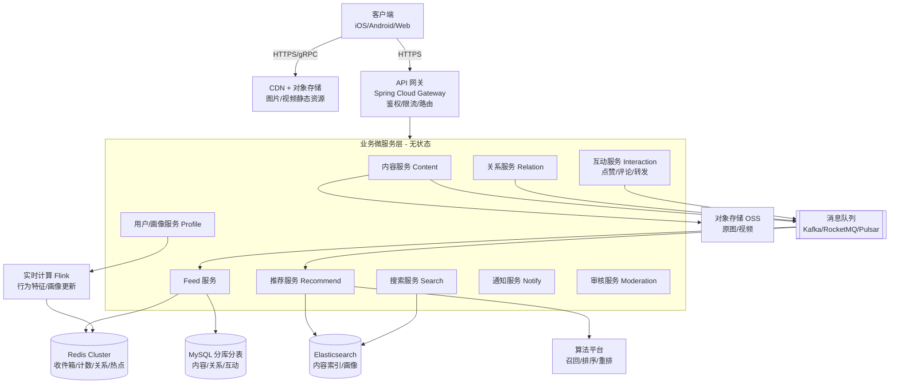
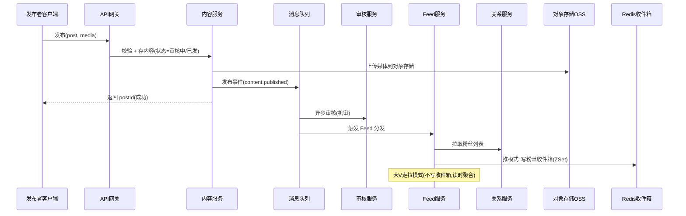
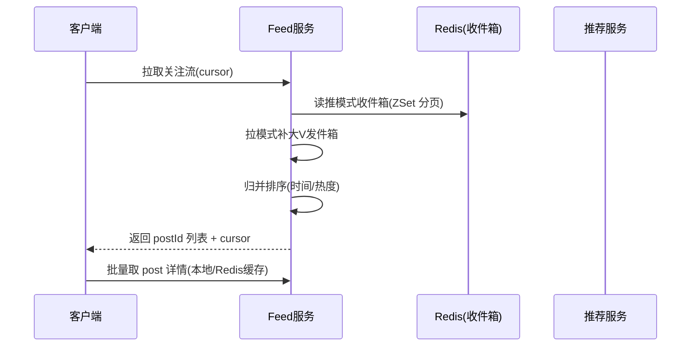

# 社交新闻系统设计与实现技术方案

> 文档定位：面向具备一定后端开发基础的工程师，系统阐述如何设计与实现一个生产级【社交新闻系统】（Social News / Feed System，产品形态对标微博、Twitter(X)、今日头条、小红书信息流）。
> 阅读完本文，你将能回答三个问题：**难在哪、怎么设计、Java 怎么落地**。

---

## 目录

1. [社交新闻系统概述](#1-社交新闻系统概述)
2. [设计社交新闻系统面临的最大难点](#2-设计社交新闻系统面临的最大难点)
3. [整体设计思路与实现路径](#3-整体设计思路与实现路径)
4. [可行的技术方案与业界成熟方案](#4-可行的技术方案与业界成熟方案)
5. [Java 技术栈的具体实现](#5-java-技术栈的具体实现)
6. [核心难点落地：Feed 分发、评论树与排序](#6-核心难点落地feed-分发评论树与排序)
7. [性能、扩展性与高可用](#7-性能扩展性与高可用)
8. [安全与合规](#8-安全与合规)
9. [总结与学习路径](#9-总结与学习路径)
10. [附录：参考方案与项目索引](#10-附录参考方案与项目索引)

---

## 1. 社交新闻系统概述

### 1.1 什么是社交新闻系统

社交新闻系统是一类以**"内容生产 + 关注关系 + 个性化信息流（Feed）"**为核心能力的互联网产品。它与传统新闻门户（编辑主导 editor-centric、全站统一首页）最大的区别在于：**每个用户看到的内容是"由他的社交关系与兴趣模型动态生成"的，千人千面**。典型产品包括微博、Twitter(X)、今日头条、小红书、Facebook News Feed 等。

一个社交新闻系统通常同时包含两类信息流：

- **关注流（Timeline / 社交流）**：用户看到的是自己**关注的人/账号**发布的内容，按时间或互动加权排序。
- **推荐流（兴趣流 / For You）**：系统根据用户的**兴趣画像与行为**，从全站内容中召回并排序后分发，不依赖关注关系。

其核心特征：

- **读写比极端且写也会爆炸**：普通用户以"读 Feed"为主（读多）；但一个千万粉丝的大 V 发一条，会瞬间触发千万级写入（写风暴）。
- **强实时性**：关注对象刚发的动态，期望在秒级出现在自己的 Feed 顶部。
- **海量内容与 UGC**：用户生产内容（UGC）占绝对主体，图片/视频/长文混合，规模以日更亿级计。
- **个性化分发**：排序不再是单纯时间序，而是"时间 + 互动热度 + 兴趣匹配"的综合排序。

### 1.2 典型场景与规模

| 场景 | 特征 | 典型要求 |
|------|------|----------|
| 微博类（关注流为主） | 关注关系 + 大 V 效应 | 高并发 Feed、写扩散优化、热点承载 |
| 头条类（推荐流为主） | 算法推荐、千人千面 | 召回/排序引擎、实时特征、低延迟 |
| 小红书类（图文社区） | 兴趣标签 + 关注 + 发现 | 内容理解、搜索、推荐融合 |
| 朋友圈类（强关系） | 双向好友、私密 | 关系链强一致、隐私控制 |
| 新闻聚合类 | 媒体源 + 订阅 | 抓取、去重、实时索引 |

一个中等规模社交新闻系统，日活（DAU）可达千万级，日均内容发布量数千万，Feed 读取请求峰值每秒数十万。规模本身会放大每一个工程难题。

### 1.3 容量估算与非功能目标（设计的前提）

架构选型不能凭感觉，必须先做**量级测算（back-of-the-envelope estimation）**——所有"要不要写扩散、Redis 要几个 T、要不要分库"的结论，都是从这张表里推导出来的。以 **DAU = 1000 万** 的中等规模系统为例：

| 维度 | 假设 | 推算 | 结论 |
|------|------|------|------|
| **Feed 读 QPS** | 人均每日刷 20 次 | 2 亿次/天 ÷ 86400 ≈ **2300 平均 QPS**，峰值系数 ×5 ≈ **1.2 万 QPS** | 单靠 MySQL 现场聚合不可能，必须缓存化 |
| **内容详情读 QPS** | 每次首屏返回 20 条 | 1.2 万 × 20 = **24 万 QPS** | 必须"收件箱只存 ID + 批量取详情 + 多级缓存" |
| **发布 TPS** | 5% 用户发文，人均 1.5 条 | 75 万条/天 ≈ **9 平均 TPS**，峰值 **50 TPS** | 写入本身很轻，**难点不在写内容，而在写扩散** |
| **写扩散放大** | 人均粉丝 200 | 75 万 × 200 = **1.5 亿次收件箱写/天**，峰值约 **1 万 ops/s** | Redis 集群可承受；但单个千万粉大 V 一条 = **1000 万次写**，必须走拉模式 |
| **正文存储** | 单条含元数据 ≈ 1KB | 750MB/天 ≈ **270GB/年** | MySQL 分片可承载，按年归档冷数据 |
| **媒体存储** | 30% 带图，人均 3 张 × 300KB | ≈ **200GB/天，70TB/年** | 必须走对象存储 + CDN，绝不入库 |
| **收件箱存储** | 1000 万用户 × 每人 1000 条 × 约 90B（ZSet member+score+开销） | ≈ **900GB Redis** | 成本不可接受 → 见下方收敛策略 |

**收件箱容量收敛策略（写扩散能否落地的关键）：**

```
900GB(理想) → 只为"近 7 天活跃用户"维护收件箱(约 30%) → 270GB
            → 收件箱长度由 1000 截断到 300 条(首屏 20 条 × 15 页足够) → 约 80GB
            → 冷用户/深翻页降级为拉模式实时聚合 → Redis 成本可控
```

**非功能目标（SLO，后续所有设计都以此为验收标准）：**

| 指标 | 目标 |
|------|------|
| Feed 首屏延迟 | P99 < 200ms（服务端） |
| 内容发布接口 | P99 < 300ms（不含媒体上传） |
| 新内容到达粉丝 Feed | P95 < 3s（推模式）/ P95 < 10s（拉模式红点） |
| 服务可用性 | 99.95%（读链路可降级不可不可用） |
| 数据一致性 | 关注关系强一致；Feed / 计数最终一致（秒级） |

---

## 2. 设计社交新闻系统面临的最大难点

很多人以为社交新闻系统的难点是"做个能发帖的界面"或"写个时间线 SQL"，其实那只是冰山一角。**真正的难点，是在「海量用户 + 复杂关注图 + 个性化分发」之上，同时满足「高并发读取、实时性、写扩散可控、分发与推荐精准、数据最终一致」这一组相互制约的目标。** 我们把它拆解为以下核心挑战，并标注其中最致命的一条。

### 2.1 ★ 最大难点：高并发 Feed 流（读扩散 vs 写扩散的权衡）

Feed 流本质上是"如何把一个用户关注的所有内容，以正确顺序高效地聚合呈现给他"。当你要同时保证下面几件事时，复杂度会指数级上升：

- **读要快**：用户下拉刷新，期望 100ms 内返回首屏，不能现场聚合上千个关注源。
- **写要可控**：一个普通用户发帖，不应拖垮系统；但一个大 V 发帖，若给每个粉丝写一条收件箱，就是**千万级写入的"写风暴"**。
- **实时**：新内容要尽快出现在粉丝 Feed 顶部，不能靠用户手动刷新才看到。
- **个性化**：Feed 不只是按时间排，还要按互动热度、兴趣加权重排。

这三点构成一个"不可能三角"式的张力：

- 想**读快** → 用"写扩散（推模式）"提前把内容写进每个粉丝收件箱，但大 V 一发就写崩。
- 想**写可控** → 用"读扩散（拉模式）"只在读取时聚合，但粉丝关注了几千人时读取极慢。
- 想兼顾 → 必须**推拉结合（混合模式）** + 大 V/普通用户分流 + 多级缓存，复杂度陡增。

**如何在"读性能、写成本、实时性"三者间取得工程平衡，是社交新闻系统设计的第一命题。** 第 3、5、6 节都是围绕它展开。

### 2.2 关注关系图（Follow Graph）的管理

- 关注/粉丝是**有向图**：A 关注 B，不代表 B 关注 A。
- 大 V 的**入边（粉丝）可达千万**，普通用户出边（关注）通常数百到数千。
- 取关时要"重建/清理"对方 Feed，不能留脏数据。
- 关系链查询高频（`我关注了谁`、`谁关注了我`、`共同关注`），必须缓存且高性能。

### 2.3 实时性与"新内容感知"

- 关注对象发新动态，如何**秒级**让粉丝感知（红点/顶部"N 条新内容"提示）？
- 推模式天然实时（写时即推）；拉模式需轮询/长轮询/WebSocket 推送"有新内容"信号，点击再拉。
- 推荐流还需把"实时行为"（刚点赞了一个话题）即时反馈到后续推荐，要求**实时特征管道**。

### 2.4 内容分发与推荐（千人千面）

- 推荐流不是简单按时间，而是**召回 → 排序 → 重排**的算法链路。
- 冷启动：新用户/新内容没有行为数据，需用热门兜底、标签召回。
- 兴趣漂移：用户兴趣会变化，模型需在线更新。
- 多样性与去重：不能连续刷出 10 条同类内容，需打散、去重、控比例。
- 低延迟：推荐链路（召回+排序）要在 **100~200ms** 内完成，否则拖累首屏。

### 2.5 数据一致性

- **关注关系 vs Feed 一致性**：关注是强一致写入，但 Feed 收件箱是异步（MQ）写入，**最终一致**。关注瞬间粉丝 Feed 可能短暂看不到新内容。
- **计数一致性**：点赞数、评论数、转发数高频更新，不能每次都落库，需 Redis 计数 + 异步落库，存在短暂不一致。
- **内容删除/修改**：作者删帖或平台下架，需级联从所有粉丝收件箱移除或标记删除，否则"已删内容还在别人 Feed 里"。
- **已读/未读与红点**：多端一致性。

### 2.6 热点与突发流量

- **大 V 发帖**：瞬时千万级读 + 写扩散风暴。
- **突发公共事件**（明星离婚、地震）：单条内容/话题瞬时亿级阅读，缓存击穿、数据库被打满。
- 需要限流、降级、热点多副本、本地缓存、异步化来兜底。

### 2.7 海量存储与成本

- 内容（文本 + 图片 + 视频）规模以 PB 计，存储成本敏感。
- 冷热分离：热内容（近期/高互动）进缓存与高速存储，冷内容归档到对象存储/列存。
- Feed 收件箱本身是"写放大"结构，存储量 = 用户数 × 收件箱长度，需 TTL 与截断（只保留最近 N 条）。

---

## 3. 整体设计思路与实现路径

### 3.1 设计原则

| 原则 | 说明 |
|------|------|
| **读写分离 + 推拉结合** | Feed 读取走"推模式收件箱 + 大 V 拉模式"，写入按粉丝规模分流，杜绝写风暴。 |
| **异步解耦** | 发布、分发、计数、审核、通知全部经消息队列异步化，主链路只做"写自己 + 发 MQ"。 |
| **计算与存储分离** | 业务无状态服务（可水平扩展） + 有状态存储/缓存（Redis/ES/DB 集群）。 |
| **多级缓存** | 本地缓存（Caffeine）+ Redis 集群 + CDN，逐级挡掉热点读。 |
| **关注流与推荐流分治** | 关注流偏"关系聚合"，推荐流偏"算法分发"，两套链路独立设计、前端融合。 |
| **一切皆可水平扩展** | 服务、缓存、存储、队列都不能有单点瓶颈。 |

### 3.2 分层架构

下面是一套生产级社交新闻系统的典型分层（mermaid 架构图）：



### 3.3 核心模块划分

| 模块 | 职责 | 关键存储 |
|------|------|----------|
| **内容服务 Content** | 发布、编辑、删除、查询帖子/图文/视频 | MySQL（分片）+ 对象存储 + ES 索引 |
| **关系服务 Relation** | 关注/取关/粉丝列表/共同关注 | MySQL（关注表）+ Redis（关系缓存） |
| **Feed 服务** | 生成与读取关注流（推拉结合） | Redis ZSet 收件箱 + MySQL 内容指针 |
| **互动服务 Interaction** | 点赞、评论、转发、收藏 | MySQL + Redis 计数 |
| **推荐服务 Recommend** | 生成兴趣流（召回→排序→重排） | ES/特征库 + 算法平台 |
| **搜索服务 Search** | 内容/用户/话题全文检索 | Elasticsearch |
| **通知服务 Notify** | 新动态红点、@、评论提醒 | Redis + MQ |
| **审核服务 Moderation** | 发前/发后内容安全审核 | 机审 API + 人审后台 |
| **用户/画像服务 Profile** | 用户资料、兴趣标签、行为画像 | MySQL + Redis + 特征存储 |

### 3.4 关键概念模型

| 概念 | 说明 |
|------|------|
| **User** | 用户，含 userId、资料、画像。 |
| **Post / Content** | 内容实体：postId、authorId、type（文本/图文/视频）、body、mediaIds、createTime、status（正常/删除/下架）。 |
| **Relation** | 关注关系：followerId → followeeId，有向。 |
| **Feed / Timeline** | 用户视角的收件箱：一组 postId 按排序键（时间/热度）组织。 |
| **Interaction** | 互动：like/comment/share，含 targetId、userId、timestamp。 |
| **Profile / Interest** | 用户兴趣标签、实时行为特征。 |

### 3.5 关键流程

**(1) 发布内容主流程**



要点：**主链路只做"写自己内容 + 发 MQ"就返回**，分发、审核、计数全部异步解耦，保证发布接口低延迟。

**(2) 读取 Feed 主流程（推拉结合）**



**(3) 关注 / 取关流程**

- 关注：写关系表（强一致）+ 更新 Redis 关系缓存 + 触发"把对方近期 N 条内容注入我收件箱"（增量推）。
- 取关：删关系 + 清缓存 + 从收件箱移除对方内容（标记删除或惰性过滤）。

### 3.6 实现路径（演进路线）

建议按以下阶段迭代，避免一上来就追求"微博级"架构：

| 阶段 | 目标 | 关键动作 |
|------|------|----------|
| **MVP** | 跑通发读 | 单机 Spring Boot + MySQL 一张 post 表 + 一条"SELECT 关注者 post ORDER BY time"SQL |
| **P2** | 解耦与缓存 | 引入 Redis 缓存 Feed/计数，MQ 异步分发，关系缓存化 |
| **P3** | 推拉结合 | 收件箱 ZSet 推模式 + 大 V 拉模式分流，分库分表 |
| **P4** | 推荐流 | 接入 ES 召回 + 简单排序（热度/兴趣标签），实时特征管道 |
| **P5** | 生产可用 | 高可用部署、限流降级、内容审核、监控压测、热点兜底 |

---

## 4. 可行的技术方案与业界成熟方案

### 4.1 Feed 流架构选型（核心）

| 模式 | 原理 | 优点 | 缺点 | 适用 |
|------|------|------|------|------|
| **写扩散 / 推模式 (Fan-out on write)** | 发帖时异步写入每个粉丝收件箱 | 读极快 O(1)、天然实时 | 写重、大 V 写风暴、存储放大 | 粉丝少的普通用户 |
| **读扩散 / 拉模式 (Fan-in on read)** | 读时聚合所有关注源再归并 | 写轻、无存储放大 | 读重（关注多时慢）、非实时 | 大 V、关注极多用户 |
| **推拉结合 (Hybrid)** | 普通用户推、大 V 拉、读取时归并 | 兼顾读写与实时 | 实现复杂、需分流策略 | 工业级主流方案 |

**业界实践：**
- **Twitter(X)**：早期纯推（写扩散），后用 **Timeline Mixer** 做推拉混合 + 读时重排。
- **微博**：推拉结合，大 V 走拉，普通用户走推，配合多机房。
- **Facebook**：以拉为主 + 重排（EdgeRank）。
- **今日头条**：推荐流为主（非关系），算法分发。

### 4.2 消息队列选型

| MQ | 特点 | 适用 |
|------|------|------|
| **Kafka** | 高吞吐、持久化、分区有序、生态强 | Feed 分发、日志、行为流 |
| **RocketMQ** | 事务消息、低延迟、阿里系成熟 | 需要事务一致的分发场景 |
| **Pulsar** | 存算分离、多租户、云原生 | 大规模多业务共用 |

Feed 分发、计数、审核、通知统一走 MQ，主链路不阻塞。

### 4.3 存储与缓存选型

| 用途 | 方案 | 说明 |
|------|------|------|
| 收件箱（Feed 指针） | **Redis ZSet** | `ZADD feed:{userId} {score} {postId}`，按游标分页 |
| 关系链缓存 | **Redis** / **Neo4j** | 关注/粉丝列表、共同关注 |
| 内容正文 | **MySQL 分库分表** + **对象存储** | 文本落库，媒体走 OSS/CDN |
| 全文检索 / 召回 | **Elasticsearch** | 内容搜索、推荐召回 |
| 冷数据归档 | **HBase / 列存 / 对象存储** | 历史内容、行为日志 |
| 计数（赞/评/转） | **Redis** + 异步落库 | 高频更新，最终一致 |
| 多级缓存 | **Caffeine（本地）+ Redis** | 挡热点、降 RT |

### 4.4 推荐系统方案

推荐链路三段式：**召回 → 排序 → 重排**。

| 阶段 | 做什么 | 常用技术 |
|------|--------|----------|
| **召回 Recall** | 从海量内容筛出千级候选 | 协同过滤（ItemCF/UserCF）、内容标签召回、双塔模型、图召回、热门兜底 |
| **排序 Rank** | 候选打分排序 | LR、FM、DeepFM、Wide&Deep、DIN（兴趣建模） |
| **重排 Rerank** | 多样性/打散/去重/控比例 | 规则 + MMR 打散 + 业务调权 |

- **离线**：Spark / Flink Batch 训练特征与模型。
- **实时**：Flink 计算用户实时行为（刚看/赞的话题），更新特征。
- **在线**：向量检索（Faiss / Milvus / Elasticsearch kNN）+ 模型推理服务（TF Serving / Triton）。
- **特征存储**：Redis / Feature Store（如 Feathr）。

> 社交新闻系统里的推荐既可用于"推荐流"，也可用于"关注流内的重排"（在你关注的人里，按兴趣/热度重排）。

### 4.5 开源方案对比（Feed / 社交 / 推荐）

| 项目 | 语言 | 特点 | 适用 |
|------|------|------|------|
| **RocketMQ** | Java | 事务消息、低延迟，适合分发 | Feed 异步分发 |
| **Kafka** | Scala/Java | 高吞吐，生态全 | 行为流、日志 |
| **Elasticsearch** | Java | 全文检索 + kNN 向量 | 搜索/召回 |
| **Milvus** | Go/C++ | 向量数据库，亿级向量检索 | 推荐向量召回 |
| **Redis** | C | ZSet/缓存/计数 | Feed 收件箱、热点 |
| **ShardingSphere** | Java | 分库分表、读写分离 | MySQL 水平扩展 |
| **Flink** | Java/Scala | 实时流计算 | 实时特征、行为管道 |
| **Apache Doris / ClickHouse** | C++ | OLAP 实时数仓 | 互动统计、数据报表 |
| **FATE / DeepRec** | - | 隐私计算 / 推荐深度学习 | 推荐模型训练 |
| **Mastodon** | Ruby | 开源去中心化微博（ActivityPub） | 学习社交 Feed 架构 |

### 4.6 商用 / 云服务方案（国内为主）

| 厂商 | 能力 | 典型场景 |
|------|------|----------|
| **阿里云 / 腾讯云 MQ + Redis + ES** | 中间件托管 | 自建系统的基础设施 |
| **火山引擎推荐引擎** | 今日头条同源推荐能力 | 推荐流开箱即用 |
| **阿里云 PAI / 腾讯云 TI-ONE** | 机器学习平台 | 自训练推荐模型 |
| **内容安全（阿里/腾讯/网易）** | 文本/图片/视频审核 | 发前/发后审核 |
| **CDN + 对象存储（OSS/COS）** | 静态资源分发 | 图片视频 |

### 4.7 自研 vs 采购决策

```
是否需要完全掌控分发与数据？
├─ 否 → 推荐流直接采购云服务(火山/PAI)，最快上线
└─ 是 → 团队有分布式经验？
        ├─ 否 → 基于开源(Redis+Kafka+ES+Flink)搭骨架，推荐用规则/简单模型起步
        └─ 是 → 自研(参考本文架构 + Java 技术栈落地)
```

---

## 5. Java 技术栈的具体实现

本节是面向 Java 工程师的落地指南，覆盖 Spring Boot/Cloud 微服务、Redis Feed、Kafka、ES、MyBatis、实时计算，并给出关键技术点与示例。

### 5.1 微服务骨架：Spring Boot + Spring Cloud

用 Spring Cloud 全家桶构建无状态业务服务：

| 组件 | 作用 |
|------|------|
| **Spring Boot** | 各业务服务基础框架 |
| **Nacos** | 注册中心 + 配置中心 |
| **Spring Cloud Gateway** | API 网关（鉴权、限流、路由） |
| **OpenFeign** | 服务间声明式调用 |
| **Sentinel** | 限流、熔断、降级 |
| **Seata** | 分布式事务（关系+内容强一致场景） |
| **Spring Boot Admin** | 服务监控 |

**服务划分示例（Maven 多模块）：**

```
social-news/
├── gateway/             # API 网关
├── service-content/     # 内容服务
├── service-relation/    # 关系服务
├── service-feed/        # Feed 服务
├── service-interaction/ # 互动服务
├── service-recommend/   # 推荐服务
├── service-search/      # 搜索服务
├── service-notify/      # 通知服务
├── common/              # 公共包(实体/工具/MQ封装)
└── api-sdk/             # 对内 Feign SDK
```

### 5.2 持久层：MyBatis / MyBatis-Plus

内容、关系、互动用 MySQL，通过 **MyBatis-Plus** 提升开发效率（分页、逻辑删除、代码生成）。

**内容实体示例：**

```java
@Data
@TableName("post")
public class Post {
    @TableId(type = IdType.ASSIGN_ID)   // 雪花 ID
    private Long postId;
    private Long authorId;
    private Integer type;                // 1文本 2图文 3视频
    private String body;
    private String mediaIds;            // 对象存储 key 列表,逗号分隔
    private Long createTime;
    private Integer status;             // 0正常 1删除 2下架
}
```

**关系（关注）表：**

```sql
CREATE TABLE `user_relation` (
  `id` BIGINT PRIMARY KEY,
  `follower_id` BIGINT NOT NULL,   -- 关注者
  `followee_id` BIGINT NOT NULL,   -- 被关注者
  `create_time` BIGINT NOT NULL,
  UNIQUE KEY `uk_pair` (`follower_id`, `followee_id`),
  KEY `idx_followee` (`followee_id`)   -- 查"谁关注了我"用
) ENGINE=InnoDB;
```

> 阿里规范提示：`follower_id`/`followee_id` 用 `BIGINT` 而非 `VARCHAR`；禁止在索引列做函数运算；单表行数超 500 万考虑分库分表（按 `follower_id` 取模）。

### 5.3 Feed 收件箱：Redis ZSet（推模式核心）

收件箱用 Redis 有序集合，score = 排序权重（时间戳或热度分），member = postId。

```java
/**
 * Feed 推模式分发服务：内容发布后，把 postId 写入粉丝收件箱（Redis ZSet）。
 * 粉丝数超过阈值的作者（大 V）不推，由读取侧走拉模式聚合，避免写风暴。
 */
@Service
@RequiredArgsConstructor
public class FeedPushService {

    private static final long PUSH_FAN_THRESHOLD = 2000;
    private static final int  MAX_INBOX_SIZE = 300;
    private static final int  FAN_PAGE_SIZE = 1000;
    private static final String INBOX_KEY = "feed:inbox:";

    private final StringRedisTemplate redis;
    private final RelationMapper relationMapper;

    /**
     * 分页拉取粉丝并用 pipeline 批量写入收件箱。
     * 分页目的：避免大结果集一次性加载导致 OOM；pipeline 目的：把 N 次 RTT 压成 1 次。
     */
    public void pushToFans(Long authorId, Long postId, double score) {
        if (relationMapper.countFans(authorId) > PUSH_FAN_THRESHOLD) {
            return;
        }
        Long cursor = 0L;
        List<Long> fans;
        while (!(fans = relationMapper.listFansAfter(authorId, cursor, FAN_PAGE_SIZE)).isEmpty()) {
            String member = String.valueOf(postId);
            redis.executePipelined((RedisCallback<Object>) conn -> {
                for (Long fan : fans) {
                    byte[] key = (INBOX_KEY + fan).getBytes(StandardCharsets.UTF_8);
                    conn.zSetCommands().zAdd(key, score, member.getBytes(StandardCharsets.UTF_8));
                    conn.zSetCommands().zRemRange(key, 0, -(MAX_INBOX_SIZE + 1));
                }
                return null;
            });
            cursor = fans.get(fans.size() - 1);
        }
    }
}
```

三个关键工程细节，缺一个就会在生产上出事：

| 细节 | 不做的后果 | 做法 |
|------|-----------|------|
| **粉丝分页游标拉取** | `listFans` 一次拉 200 万粉丝，服务直接 OOM | 按 `follower_id` 递增游标分页，每批 1000 |
| **pipeline 批量写** | 1000 个粉丝 = 1000 次 RTT，单次分发耗时数秒 | `executePipelined` 合并成 1 次网络往返 |
| **ZSet 定长截断** | 收件箱无限增长，Redis 内存被打爆 | 每次写入后 `zRemRange(0, -(N+1))` 只留最近 N 条 |

> 消费端必须**幂等**：MQ 至少一次投递，重复消费时 `ZADD` 同一个 member 只会覆盖 score，天然幂等——这正是"收件箱用 ZSet 而不用 List"的隐含收益（用 List 会出现重复内容）。

**读取 Feed（游标分页）：**

```java
/**
 * 游标分页读取收件箱：取 score 小于上一页最小 score 的前 limit 条，等价于"下一页"。
 * 首页传入 Double.MAX_VALUE 作为游标。
 */
public List<Long> readInbox(Long userId, double cursorScore, int limit) {
    Set<String> ids = redis.opsForZSet().reverseRangeByScore(
            INBOX_KEY + userId, 0, cursorScore - 1, 0, limit);
    if (CollectionUtils.isEmpty(ids)) {
        return Collections.emptyList();
    }
    return ids.stream().map(Long::valueOf).collect(Collectors.toList());
}
```

> 用 **游标分页（cursor-based）** 替代 `LIMIT offset`，避免深翻页性能悬崖；游标取 `(score, postId)` 复合值防同分乱序。

### 5.4 拉模式归并（大 V 补拉 + K 路归并）

读取时，对"关注的大 V"实时拉其发件箱，与普通收件箱归并：

```java
public List<Long> readFeedHybrid(Long userId, long cursor, int limit) {
    // 1) 推模式收件箱
    List<Long> pushList = readInbox(userId, cursor, limit);
    // 2) 拉模式: 关注的大V(粉丝>阈值)的发件箱
    List<Long> bigVList = relationMapper.listBigVFollowees(userId).stream()
        .flatMap(bv -> readOutbox(bv, cursor, limit / 2).stream())
        .collect(Collectors.toList());
    // 3) K 路归并(按 score 降序)
    return mergeByScore(pushList, bigVList, limit);
}
```

### 5.5 异步解耦：Kafka / RocketMQ

发布事件解耦分发、计数、审核：

```java
// 生产者: 内容服务发布后发事件
public void onPublished(Post post) {
    kafkaTemplate.send("content-published",
        new ContentPublishedEvent(post.getPostId(), post.getAuthorId()));
}

// 消费者: Feed 服务订阅, 触发分发
@KafkaListener(topics = "content-published")
public void consume(ContentPublishedEvent evt) {
    feedPushService.pushToFans(evt.getAuthorId(), evt.getPostId(), evt.getScore());
    notifyService.newContentSignal(evt.getAuthorId()); // 红点信号
}
```

**可靠性要点：**
- 消费端**幂等**（按 `postId + userId` 去重），MQ 可能重复投递。
- 重要分发用 **RocketMQ 事务消息** 或 **本地消息表** 保证"内容落库"与"事件投递"最终一致。
- 死信队列兜底多次失败的消息。

### 5.6 搜索与召回：Elasticsearch

内容发布后建/更新 ES 索引，用于搜索与推荐召回：

```java
@Document(indexName = "post")
public class PostDoc {
    @Id private Long postId;
    private Long authorId;
    private String body;
    private List<String> tags;      // 内容理解打标
    private Double hotScore;        // 互动热度
    private Long createTime;
}
// 推荐召回: 按用户兴趣标签 term 查询 + 热度排序,取 topN 候选
```

- **召回**：ES `bool` 查询按兴趣标签/话题拉候选，或用 `knn` 向量召回（配合 Milvus）。
- **排序**：业务层接模型打分（DeepFM/DIN）。

### 5.7 互动与计数：Redis 计数 + 异步落库

```java
/**
 * 点赞：用 Set 保证一人一次（SADD 返回 1 表示首次），计数走 Redis 原子自增，
 * 落库与热度更新经 MQ 异步完成。返回值可能为 null，必须判空后再拆箱比较。
 */
public boolean like(Long postId, Long userId) {
    Long added = redis.opsForSet().add("like:set:" + postId, String.valueOf(userId));
    if (added == null || added == 0L) {
        return false;
    }
    redis.opsForValue().increment("like:count:" + postId);
    likeMQ.send(new LikeEvent(postId, userId));
    return true;
}
```

- 计数先写 Redis，定时/定量落 MySQL，容忍秒级不一致。
- 热度分 `hotScore = f(点赞, 评论, 转发, 时间衰减)`，用于 Feed 重排。

### 5.8 实时特征：Flink（Java/Scala API）

用户实时行为（浏览/点赞/停留）经 Kafka 流入 Flink，更新画像特征，供推荐实时反馈：

```java
stream.keyBy(Behavior::getUserId)
      .window(TumblingEventTimeWindows.of(Time.minutes(5)))
      .aggregate(new InterestAggregate())      // 统计兴趣标签权重
      .addSink(new RedisFeatureSink());        // 写 Redis 特征
```

### 5.9 内容审核

- **发前机审**：发布接口同步/异步调用内容安全 API（文本/图片/视频），命中违规拦截或标"待审"。
- **发后巡审**：MQ 异步二次审核，命中下架并级联清理 Feed（标记 `status=2`，读取时过滤）。
- 人审后台处理机审不确定的"灰度"内容。

### 5.10 服务治理与工程化

- **网关**：Spring Cloud Gateway 统一鉴权（JWT）、限流（Sentinel 网关流控）。
- **配置/注册**：Nacos。
- **容器化 + K8s**：各服务独立弹性扩缩。
- **可观测性**：Prometheus + Grafana（Feed QPS、P99 延迟、缓存命中率、MQ 积压），OpenTelemetry 链路追踪。
- **限流降级**：Sentinel 保护 Feed/推荐接口，热点参数限流（按 postId）。

---

## 6. 核心难点落地：Feed 分发、评论树与排序

把第 2.1 节的最大难点落到可执行机制上。

### 6.1 三种模式对比与选型决策

```
发帖请求
├─ 作者粉丝数 ≤ 阈值(如2000) → 推模式: 异步写每个粉丝收件箱(ZSet)
├─ 作者粉丝数 >  阈值          → 拉模式: 只写自己发件箱, 读时聚合
└─ 读取 Feed → 推收件箱 ∪ 拉大V发件箱 → 归并排序
```

- **推模式**保证读快且实时，但需截断收件箱（只留最近 N 条，如 1000）控制存储放大。
- **拉模式**用"关注列表 + 各源最近 N 条 + K 路归并"，关注数过大时（>2000）需限制聚合窗口或改推。
- **大 V 动态权重**：拉模式下大 V 内容按热度加权进入归并，避免被淹没。

### 6.2 排序键设计

| 排序 | score 公式 | 说明 |
|------|-----------|------|
| 纯时间 | `createTime` | 简单，关注流默认 |
| 时间衰减热度 | `log(互动数+1) / (age+2)^1.5` | Hacker News / 微博热门 |
| 兴趣加权 | `base + α·兴趣匹配度` | 推荐流/重排 |

```java
double score = Math.log10(likeCount + commentCount*2 + 1)
             / Math.pow((now - createTime)/3600000.0 + 2, 1.5);
```

### 6.3 实时性保障

- **推模式**：写收件箱即实时，粉丝下拉即见。
- **拉模式**：Feed 服务推"有新内容"信号（Redis 发布订阅 / WebSocket），客户端显示红点/顶部提示，点击再拉。
- **通知服务**：`@、评论、点赞`走 MQ 实时通知。

### 6.4 一致性保障（不脏、不丢、可控）

- **关注瞬间可见**：关注后异步把对方近期 N 条注入我收件箱（增量推），容忍秒级延迟。
- **删帖级联**：作者删帖 → MQ 广播 `post.deleted` → 所有粉丝收件箱 `ZREM` 该 postId（或读取时按 `status` 过滤）。
- **计数最终一致**：Redis 计数 + 定时落库，页面展示允许短暂偏差。
- **去重**：消费端按 `(userId, postId)` 幂等，防止重复写入收件箱。

### 6.5 存储放大与成本权衡

- 收件箱只存 **postId 指针**（不存正文），读时批量取详情（走本地缓存 + Redis）。
- 收件箱 TTL + 长度截断（ZSet 只留最近 1000 条），冷用户清理。
- 内容正文冷热分离：热 MySQL、冷归档对象存储/列存。

### 6.6 评论树与投票排序（社交新闻形态的另一半）

"社交新闻"这个品类除了微博式关注流，还有 **Reddit / Hacker News / V2EX 式的"投票 + 讨论"形态**。这条链路的两个核心难点是：**评论树怎么存怎么分页**、**帖子怎么按"投票 + 时间"排序**。

**(1) 评论树的三种建模方案**

| 方案 | 结构 | 查询代价 | 适用 |
|------|------|----------|------|
| **邻接表**（`parent_id`） | 只存父指针 | 取整棵树需递归/多次查询，深树灾难 | 层级极浅 |
| **两级扁平化**（`root_id` + `parent_id`） | 主楼 + 楼中楼两层，回复更深层时仍挂到 `root_id` | 一次查询取主楼，一次批量取楼中楼，**O(1) 次 IO** | ★ 微博/小红书/B 站，工程首选 |
| **物化路径**（`path` 如 `0001.0007.0031`） | 路径前缀编码层级 | `WHERE path LIKE '0001.%' ORDER BY path` 一次拿整棵有序子树 | Reddit 式无限层级 |

推荐**两级扁平化**：它把"无限嵌套"这个 UI 幻觉用两层结构承载，避免了递归查询与深度不可控。

```sql
CREATE TABLE `comment` (
  `comment_id`   BIGINT       NOT NULL PRIMARY KEY,
  `post_id`      BIGINT       NOT NULL,
  `root_id`      BIGINT       NOT NULL DEFAULT 0,
  `parent_id`    BIGINT       NOT NULL DEFAULT 0,
  `user_id`      BIGINT       NOT NULL,
  `reply_to_uid` BIGINT       NOT NULL DEFAULT 0,
  `content`      VARCHAR(2000) NOT NULL,
  `like_count`   INT          NOT NULL DEFAULT 0,
  `reply_count`  INT          NOT NULL DEFAULT 0,
  `status`       TINYINT      NOT NULL DEFAULT 0,
  `create_time`  BIGINT       NOT NULL,
  KEY `idx_post_root_time` (`post_id`, `root_id`, `create_time`),
  KEY `idx_root_time` (`root_id`, `create_time`)
) ENGINE=InnoDB;
```

- `root_id = 0` 表示主楼评论；`root_id = 主楼ID` 表示楼中楼回复；`reply_to_uid` 用于渲染"回复 @某人"。
- **分页策略**：先按 `idx_post_root_time` 游标取 20 条主楼，再用 `root_id IN (...)` **批量**取每个主楼的前 3 条楼中楼 + `reply_count`，前端显示"共 N 条回复 › 展开"。**严禁 N+1 查询**（20 个主楼查 20 次楼中楼）。
- `reply_count` / `like_count` 是**冗余计数**，用 `UPDATE ... SET reply_count = reply_count + 1` 原子自增，禁止"查出来 +1 再写回"。

**(2) 投票排序算法（决定首页长什么样）**

| 算法 | 公式 | 特性 | 代表 |
|------|------|------|------|
| **Hacker News** | `(P - 1) / (T + 2)^1.8` | 简单、强时间衰减，新内容有机会 | HN |
| **Reddit hot** | `sign(s)·log10(max(abs(s),1)) + t/45000`，其中 `s = ups − downs` | 对数压缩票数（第 10 票权重 ≫ 第 1000 票），只随时间单向前进 | Reddit 首页 |
| **Reddit best**（Wilson 置信下界） | `(p + z²/2n − z·√((p(1−p) + z²/4n)/n)) / (1 + z²/n)` | 解决"10 赞 0 踩 vs 200 赞 50 踩谁更好"，样本少时保守 | Reddit 评论区默认排序 |
| **争议度 controversial** | `(up+down)^min(up/down, down/up)` | 找出"两极分化"内容 | Reddit 争议榜 |

```java
/**
 * 帖子/评论排序打分工具。
 * hotScore 用于列表排序（写入 Redis ZSet 的 score）；
 * wilsonScore 用于评论区"最佳排序"，在票数样本较小时给出保守估计。
 */
public final class RankingScorer {

    private static final double Z = 1.96;
    private static final long REDDIT_EPOCH = 1134028003L;

    public static double hotScore(long ups, long downs, long createTimeSec) {
        long s = ups - downs;
        double order = Math.log10(Math.max(Math.abs(s), 1));
        int sign = Long.signum(s);
        return sign * order + (createTimeSec - REDDIT_EPOCH) / 45000.0;
    }

    /**
     * Wilson 得分置信区间下界：把"好评率"按样本量折价，避免小样本高分刷榜。
     */
    public static double wilsonScore(long ups, long total) {
        if (total == 0) {
            return 0d;
        }
        double p = (double) ups / total;
        double numerator = p + Z * Z / (2 * total)
                - Z * Math.sqrt((p * (1 - p) + Z * Z / (4.0 * total)) / total);
        return numerator / (1 + Z * Z / total);
    }
}
```

**(3) 工程落地要点**

- 排序分**不要在读时实时计算全表**：投票事件经 MQ 触发重算，把新分数 `ZADD` 进 `rank:hot:{板块}` 有序集合，读取只做 `ZREVRANGE` 分页。
- **时间衰减需要"复活"机制**：Reddit hot 的 `t/45000` 项让新帖天然占优，无需定时刷全站；若用 HN 公式（分母含当前时间），必须定时任务滚动重算最近 24h 内容，否则榜单会僵死。
- **防刷票**：`vote` 表 `UNIQUE KEY (target_id, user_id)` 保证一人一票，改票用 `INSERT ... ON DUPLICATE KEY UPDATE`；配合设备指纹 + 频率限流治理水军。

---

## 7. 性能、扩展性与高可用

### 7.1 多级缓存挡热点

```
请求 → Caffeine(本地, 进程内) → Redis Cluster → DB/ES
```

- 热点内容（突发事件）进本地缓存 + Redis 多副本，避免缓存击穿。
- **缓存击穿**：热点 key 用互斥锁（Redis `SETNX`）单飞重建。
- **缓存雪崩**：过期时间加随机抖动。
- **缓存穿透**：空值缓存 + 布隆过滤器（postId 存在性）。

### 7.2 分库分表与读写分离

- 内容表按 `authorId` 或 `postId` 哈希分片（ShardingSphere）。
- 关系表按 `follower_id` 分片；查"粉丝列表"走 `idx_followee` 反向索引。
- MySQL 主从读写分离，读走从库。

### 7.3 限流与降级

- 网关/接口级限流（Sentinel），按用户、按接口、按热点参数（postId）。
- 降级：推荐流不可用时，fallback 到"关注流 + 热门兜底"，保证主功能可用。
- 大 V 发帖写扩散限流 + 批处理合并（Redis pipeline 批量写）。

### 7.4 多活与容灾

- Redis Cluster + MySQL MGR 多副本，防止单点。
- 跨机房多活：按 `userId` 哈希分片，单机房故障只影响部分用户，路由可切换。
- 全链路压测指标：Feed 读取 P99 延迟、发布接口 RT、缓存命中率、MQ 积压、推荐链路耗时。

---

## 8. 安全与合规

- **传输层**：全链路 HTTPS/TLS 1.3。
- **认证授权**：登录 JWT + 刷新机制；网关统一鉴权；接口级权限（如删帖仅作者/管理员）。
- **内容合规**：发前/发后机审 + 人审，满足监管要求（国内场景必备）；敏感词、涉政涉黄、侵权检测。
- **隐私合规**：关注关系隐私（私密关注）、数据最小化、被遗忘权（删号级联清理）、留存策略（GDPR/《个人信息保护法》）。
- **防刷与风控**：发布频率限制、机器人识别、水军治理、评论区风控。
- **审计**：操作与内容审计日志，便于溯源。

---

## 9. 总结与学习路径

### 9.1 一句话总结

社交新闻系统看似只是"发帖刷信息流"，实则是对**分布式存储、缓存、消息队列、推荐算法、一致性、高并发**综合功力的考验。一句话概括设计哲学：

> **用"推拉结合的 Feed 收件箱 + 异步消息总线 + 多级缓存"，在海量关注图之上实现"读快、写可控、实时、个性化"的信息流，并通过关系缓存、分库分表、限流降级化解规模化带来的写风暴与热点。**

### 9.2 Java 工程师学习路径

**Java 工程师学习路径建议：**

1. **基础**：吃透 Spring Boot / Spring Cloud、MySQL 索引与分库分表、Redis 数据结构（尤其 ZSet）。
2. **Feed 核心**：手写推模式（Redis ZSet 收件箱）+ 拉模式（K 路归并），理解推拉结合分流。
3. **异步 MQ**：用 Kafka/RocketMQ 做发布-分发解耦，实现幂等消费与事务消息。
4. **搜索/召回**：Elasticsearch 建索引、bool 查询、knn 向量召回入门。
5. **推荐入门**：协同过滤 + 热度排序 + 兴趣标签召回，再过渡到 DeepFM/DIN。
6. **实时计算**：Flink 消费行为流更新特征。
7. **工程化**：分库分表（ShardingSphere）、Sentinel 限流、K8s 部署、Prometheus 监控。
8. **读源码**：研究 Mastodon（社交 Feed 架构）、RocketMQ/Kafka、Redis ZSet 实现。

### 9.3 常见追问速答（设计评审 / 面试高频 10 问）

| # | 问题 | 速答要点 |
|---|------|----------|
| 1 | 为什么不能直接 `WHERE author_id IN (关注列表) ORDER BY create_time LIMIT 20`？ | 关注 2000 人时 `IN` 列表巨大、跨分片无法下推、`ORDER BY` 需全量排序；QPS 上万时 MySQL 必挂。必须缓存化收件箱。 |
| 2 | 推拉阈值（如 2000 粉）怎么定？ | 用"写扩散成本 ≤ 可接受峰值 ops/s"反推：阈值 × 峰值发布 TPS ≤ Redis 写入预算。同时结合粉丝数长尾分布（99% 用户 < 2000 粉），让绝大多数走推。 |
| 3 | 收件箱为什么用 ZSet 而不是 List？ | ZSet 天然按 score 排序、支持范围游标分页、重复 `ZADD` 幂等（List 会重复插入）、可定长截断。代价是内存开销更大。 |
| 4 | 深翻页怎么处理？ | 收件箱只保留最近 N 条（如 300），超出部分**降级为拉模式**实时聚合历史；游标用 `(score, postId)` 复合值，禁用 `LIMIT offset`。 |
| 5 | 大 V 发帖，粉丝为什么可能延迟才看到？ | 大 V 走拉模式，粉丝需在读取时聚合；靠"新内容信号"（Redis Pub/Sub + 长连接红点）把延迟感知降到秒级，点击再拉。 |
| 6 | 删帖后如何保证不出现在别人 Feed？ | 双保险：MQ 广播 `post.deleted` 异步 `ZREM` 各粉丝收件箱（尽力而为）+ **读取时按 `status` 过滤**（兜底，必须有）。只靠前者一定会漏。 |
| 7 | 点赞数为什么允许不准？ | 高频写不落库，Redis 原子自增 + 定量/定时批量落 MySQL；展示层容忍秒级偏差，业务上无资损。关键是**去重集合保证"我赞过"状态准确**。 |
| 8 | 关注新用户后，历史内容要不要灌进收件箱？ | 灌，但只灌"最近 N 条"（如 20 条）且异步执行；不灌会导致刚关注就看到空白 Feed，全灌会造成写放大。 |
| 9 | 如何避免 Feed 里出现重复内容（多人转同一条）？ | 收件箱 member 存 `postId`（ZSet 自动去重）；转发场景 member 用原始 `postId`，`score` 取最新一次转发时间，读取时按"原文 ID"二次去重。 |
| 10 | 突发热点导致缓存击穿怎么兜底？ | 热点识别（滑动窗口计数）→ 提升为本地 Caffeine 缓存 + Redis 多副本；重建加互斥锁单飞；极端情况按热点参数（postId）限流 + 静态化降级。 |

---

## 10. 附录：参考方案与项目索引

**开源：**
- Mastodon（去中心化微博，ActivityPub）：https://github.com/mastodon/mastodon
- RocketMQ（Java MQ，事务消息）：https://github.com/apache/rocketmq
- Kafka：https://github.com/apache/kafka
- Elasticsearch：https://github.com/elastic/elasticsearch
- Milvus（向量数据库）：https://github.com/milvus-io/milvus
- Redis：https://github.com/redis/redis
- Apache ShardingSphere（分库分表）：https://github.com/apache/shardingsphere
- Apache Flink（实时计算）：https://github.com/apache/flink
- Apache Doris / ClickHouse（OLAP）：https://github.com/apache/doris 、https://github.com/ClickHouse/ClickHouse

**商用/云：**
- 火山引擎推荐引擎：https://www.volcengine.com/product/ria
- 阿里云 PAI：https://www.aliyun.com/product/bigdata/learn
- 腾讯云 TI-ONE：https://cloud.tencent.com/product/tione
- 阿里云/腾讯云 内容安全：对应官网内容安全产品
- 对象存储 OSS / COS + CDN：对应官网

**延伸阅读：**
- Twitter《Timeline Mixer》工程博客（推拉混合架构）
- 微博 Feed 架构演进（大 V 写扩散优化）
- Facebook EdgeRank（社交重排）
- 《Redis 设计与实现》（ZSet / 跳表）
- 王喆《深度学习推荐系统》（召回/排序/重排）
- 阿里巴巴 Java 开发手册（数据库/SQL 规约）

---

## 变更记录

| 日期 | 变更内容 |
|------|----------|
| 2026-08-16 | 初版：难点分析、分层架构、方案选型、Java 落地、Feed 推拉结合、性能与合规 |
| 2026-08-16 | 增补：§1.3 容量估算与 SLO 目标；§5.3 推模式代码升级为分页游标 + pipeline + 定长截断；§6.6 评论树建模与投票排序算法（HN / Reddit hot / Wilson）；§9.3 高频追问速答 10 问 |

> 维护约定：新增或修改章节时，同步更新目录与本变更记录，保持文档与实现一致。

---

*本文为技术方案概述文档，落地实现时请结合具体业务规模、合规要求与团队能力做裁剪与演进。*
