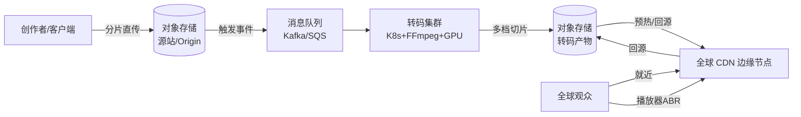
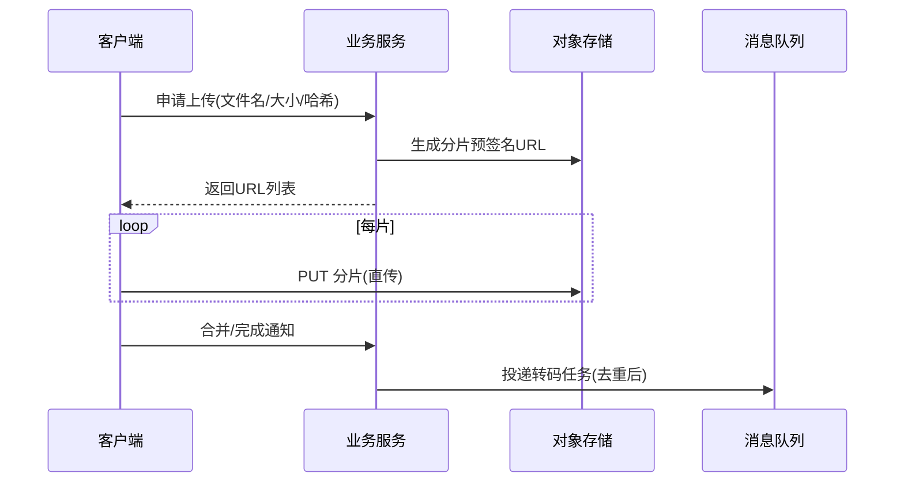
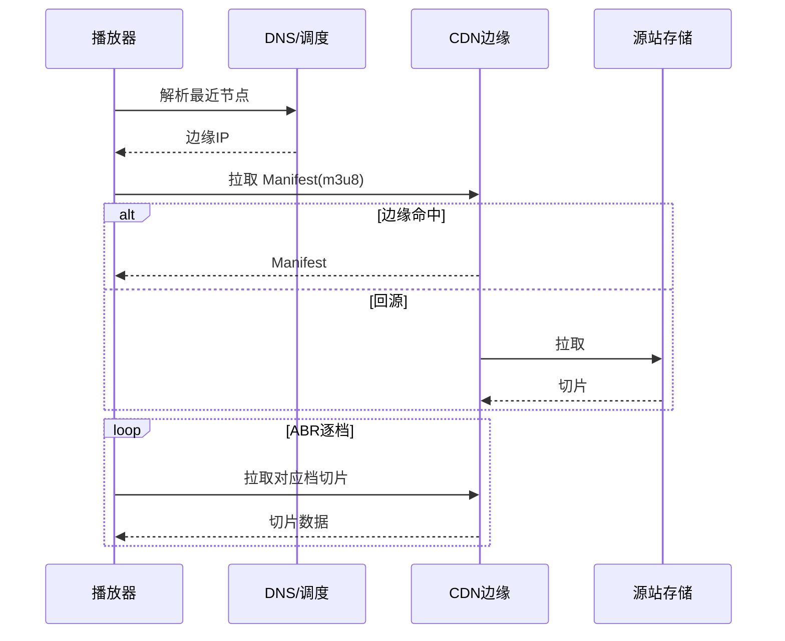
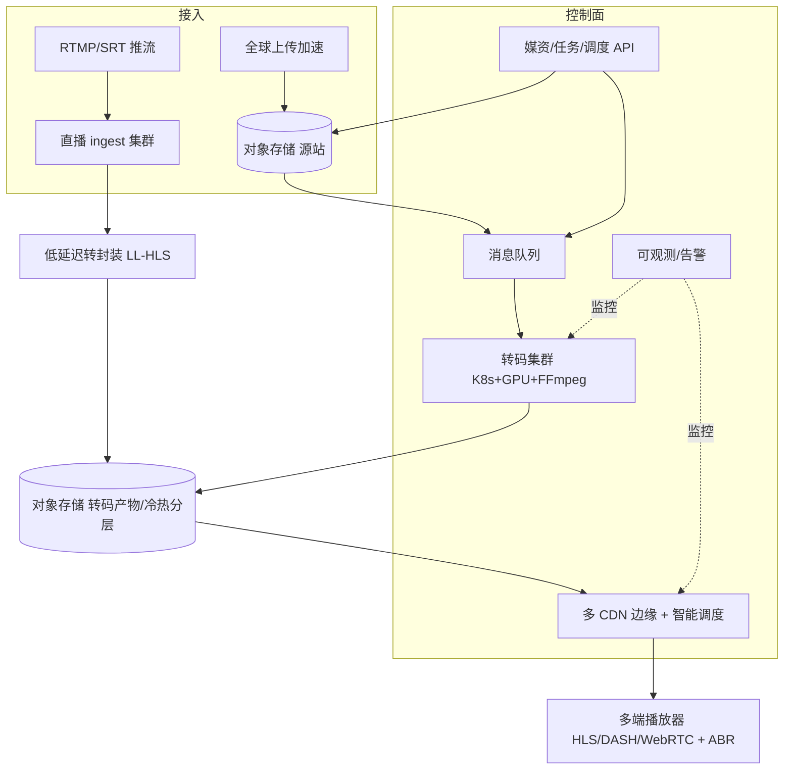

# 全球视频流系统 · 系统方案设计

> 文档定位：一份可直接用于架构评审 / 高级工程师面试的系统方案设计。
> 范围：面向**全球用户**的点播（VOD）+ 直播（Live）视频流系统，覆盖**上传 → 转码 → 存储 → 分发（CDN）→ 播放**全链路；支持多清晰度（1080p / 720p / 480p / 360p 等）与基于 CDN 的全球低延迟播放。
> 约定：文中量化指标为**假设的典型量级（以千万级 DAU、亿级播放为基准）**，用于推导容量与选型，落地时按实际业务校准。

---

## 0. 阅读导航

| 章节 | 内容 |
|---|---|
| 1. 核心需求 | 完整业务流程、多清晰度、全球低延迟播放的目标与非功能约束 |
| 2. 技术方案 | 上传 / 转码 / 分发 / 播放 四阶段的可行实现方案 |
| 3. 方案对比 | 转码方式、传输协议、存储架构、封装/编码格式的方案优劣对比 |
| 4. 实际可行性 | 从工程落地、成本、运维三个维度评估各方案 |
| 5. 最大难点与推荐方案 | 核心技术挑战、最合理方案、推荐技术架构与编程语言建议 |

---

## 1. 核心需求

### 1.1 功能性需求

1. **视频上传**：用户/创作者将原始视频（可能数 GB、数小时）可靠上传至系统，支持断点续传、秒传、全球就近上传。
2. **视频转码**：将单一原始文件转码为多档清晰度（1080p / 720p / 480p / 360p 等），并生成**自适应码率（ABR）**切片，兼容主流编码（H.264 / H.265 / AV1）。
3. **视频存储**：海量转码产物（切片、封面、元数据）低成本、高持久、可全球复制地持久化。
4. **视频分发**：基于 CDN 将内容缓存到离用户最近的边缘节点，实现全球低延迟播放。
5. **视频播放**：多端（Web / iOS / Android / TV）流畅播放，自动按带宽切换清晰度，首帧快、卡顿少。
6. **附加能力**：直播低延迟（< 3s）、DRM 版权保护、防盗链、审核、播放统计。

### 1.2 非功能需求（量级假设）

| 指标 | 假设值 | 说明 |
|---|---|---|
| 日上传视频 | 50 万条（峰值数万 QPS 上传流） | 单文件 200MB~5GB |
| 日播放量 | 1 亿次 | 读:写 ≈ 200:1 |
| 首帧时间（首屏渲染） | < 1s（P95） | 用户体感敏感 |
| 卡顿率（Rebuffer Ratio） | < 0.5% | 核心体验指标 |
| 播放延迟（直播） | < 3s（低延迟）/ < 1s（超低延迟） | 互动直播要求更严 |
| 可用性 | 99.95%（年停机 < 4.4h） | 播放主链路不可长挂 |
| 存储持久性 | 99.999999999%（11 个 9，对象存储级） | 源片不可丢 |
| 覆盖 | 全球多地域（亚太 / 欧美 / 中东 / 南美） | 跨国就近接入 |

> 关键结论：**视频流是典型的「写重（转码算力）+ 读极重（带宽/存储）、对延迟与成本双重敏感」系统**。架构重心应放在「上传可靠 + 转码经济 + CDN 分发降本 + 播放体验优化」上。

### 1.3 端到端完整流程

完整生命周期：

1. **上传**：客户端经「全球上传加速」分片直传对象存储（预签名 URL，不经业务服务器），完成后写元数据并投递转码任务消息。
2. **转码**：转码集群消费消息，按预设档位（如 1080p/720p/480p/360p）并行转码 + 切片（HLS/DASH），写入转码产物存储，并更新媒资状态。
3. **存储**：源片与转码切片分层存于对象存储（热/冷/归档），跨地域复制满足就近与容灾。
4. **分发**：CDN 边缘节点缓存切片；观众请求命中边缘即返回，未命中回源拉取并缓存。
5. **播放**：播放器拉取 Manifest（m3u8/mpd），按实时带宽通过 ABR 选择档位，边下边播。

### 1.4 多清晰度要求

- **档位设计**：典型 4 档——1080p（6~8 Mbps）、720p（3~4 Mbps）、480p（1~1.5 Mbps）、360p（0.6~0.8 Mbps）；移动端可加 144p。
- **实现方式**：转码阶段一次性生成全部档位切片；播放端通过 ABR 算法（如 BOLA / Dynamic ADAptive Streaming over HTTP 中的缓冲模型）在档位间平滑切换，弱网自动降档、带宽恢复升档。
- **首帧优化**：优先预取最低档首个切片，先出画面再升档。

### 1.5 基于 CDN 的全球低延迟播放

- **边缘缓存**：HLS/DASH 切片天然小文件（数秒一片），极适合 CDN 缓存命中，回源率可压到个位数百分比。
- **就近接入**：通过 DNS 解析 / Anycast / HTTPDNS 将用户导向最近 POP（Point of Presence）。
- **多 CDN 调度**：主备多 CDN 厂商，按质量（丢包、RTT、命中率）实时选路，避免单厂商区域故障。
- **直播低延迟**：采用 **LL-HLS / LL-DASH**（分片部分化、阻塞加载）或 **WebRTC**（< 1s，但成本高）将延迟从传统 HLS 的 6~30s 压到 3s 内。

---

## 2. 技术方案（四阶段）

### 2.1 上传阶段

| 方案要点 | 说明 |
|---|---|
| **客户端分片直传（核心）** | 客户端把大文件按 5~10MB 切片，通过**预签名 URL** 直接 PUT 到对象存储（OSS/S3），业务服务器只签发 URL 与记录元数据，**不经应用服务器转发**，省带宽、易扩展 |
| **断点续传** | 每片独立上传并记录已传 offset / ETag；失败后仅重传缺失分片 |
| **秒传（去重）** | 上传前计算文件整体哈希（或前 N MB 哈希），服务端已存在则直接复用，避免重复存储与转码（节省 30%+ 存储） |
| **全球上传加速** | 使用云厂商「全球加速 / Transfer Acceleration」：上传流量先就近进入边缘，再走厂商内网骨干回源，跨国上传提速数倍 |
| **元数据与任务投递** | 上传完成回调业务服务，写媒资表并将转码任务发往 MQ，解耦上传与转码 |

### 2.2 转码阶段

| 方案要点 | 说明 |
|---|---|
| **转码引擎** | 以 **FFmpeg** 为核心（事实标准）；云托管（AWS MediaConvert / 阿里云 MTS / 腾讯云 VOD）免运维，自建则用 FFmpeg + 自研调度 |
| **算力形态** | **GPU 转码**（NVIDIA NVENC，单卡并行数十路，单位成本最低）用于大规模点播；**CPU 转码**（x264/x265）用于小批量/灵活参数；AV1 编码以 CPU 为主（慢但免专利） |
| **分布式集群** | K8s 部署无状态转码 Worker，消费 MQ 任务；按清晰度档位并行多条流水线；可按队列深度 HPA 弹性扩缩 |
| **预转码 vs 即时转码** | **预转码**（上传后异步转全档）：播放零等待，适合长尾热门内容；**即时转码/JIT**（首播时才转）：省存储，适合冷内容（延迟首帧） |
| **编码与封装** | 编码 H.264（兼容）/ H.265（省带宽）/ AV1（未来）；封装为 HLS（.ts/.m4s）+ DASH（.mp4/ fragmented） |
| **缩略图/雪碧图/字幕** | 转码流水线一并抽取关键帧、生成雪碧图（进度条预览）与多语言字幕轨道 |

### 2.3 分发阶段（CDN）

| 方案要点 | 说明 |
|---|---|
| **CDN 边缘缓存** | 切片小文件缓存命中率高；配置合理 TTL 与缓存键（按 URL），Manifest 短 TTL、切片长 TTL |
| **回源策略** | 源站为对象存储 + 轻量回源服务；支持 Range 请求、304 协商；突发回源用回源限速/合并保护源站 |
| **防盗链与安全** | Referer 校验、URL 鉴权（时间戳 + 签名）、Token 校验；结合 DRM 防下载 |
| **多 CDN 与调度** | 主备多厂商，HTTPDNS/调度服务按实时质量（RTT、丢包、命中率、成本）选路，单厂商故障秒级切换 |
| **边缘计算（进阶）** | 在边缘节点做 Manifest 动态拼装、ABR 决策辅助、低延迟转封装（如将 RTMP 在边缘转 LL-HLS） |

### 2.4 播放阶段

| 方案要点 | 说明 |
|---|---|
| **播放协议** | 点播主用 **HLS / DASH**（HTTP 友好、CDN 友好）；直播低延迟用 **LL-HLS / LL-DASH / WebRTC** |
| **播放器** | Web 用 hls.js / dash.js / video.js；iOS 用 AVPlayer（原生支持 HLS）；Android 用 ExoPlayer；TV 用对应原生 SDK |
| **ABR 自适应** | 播放器内置带宽探测 + 缓冲模型，自动选档；服务端可下发「档位建议」辅助决策 |
| **首帧优化** | 预连接（preconnect）、首片预取、低档优先出画、P2P/就近预热 |
| **弱网与 QoS** | 自适应缓冲、丢包重传（QUIC）、卡顿上报；结合数据做 CDN 调度优化 |
| **DRM 与版权** | Widevine（Android/Chrome）/ FairPlay（Apple）/ PlayReady（Win），服务端签发许可证 |

---

## 3. 方案对比

### 3.1 转码方式对比

| 方案 | 优点 | 缺点 | 适用 |
|---|---|---|---|
| **云托管转码（MediaConvert/MTS/VOD）** | 免运维、弹性、稳定、自带多格式/DRM | 单价高、定制化弱、数据出厂商边界 | ✅ 多数团队起步/中小规模首选 |
| **自建 GPU 集群（FFmpeg + K8s + NVENC）** | 单位转码成本最低、完全可控、可深度优化 | 运维重、GPU 采购/调度难、扩容周期长 | 海量点播（日均数十万+ 转码） |
| **CPU 软转（x264/x265）** | 灵活、无需 GPU、画质调优空间大 | 慢、并行度低、单位成本高 | 小批量/特殊参数/AV1 |
| **预转码（全档预生成）** | 播放零等待、体验最佳 | 存储与算力前置消耗大 | 热门/确定会上线内容 |
| **即时转码（JIT）** | 省存储、按需计算 | 首播冷启动延迟、源站压力集中 | 长尾冷内容 |

> 结论：混合策略最优——**热门内容预转码 + 冷内容 JIT**，引擎以云托管起步、规模上来后迁自建 GPU。

### 3.2 传输协议对比

| 协议 | 延迟 | 兼容性 | 扩展性/成本 | 适用场景 |
|---|---|---|---|---|
| **HLS（Apple）** | 6~30s（LL-HLS < 3s） | ⭐⭐⭐⭐⭐ 全平台原生 | CDN 极友好、低成本 | ✅ 点播与大部分直播 |
| **DASH（MPEG）** | 同 HLS（LL-DASH < 3s） | ⭐⭐⭐⭐ 需播放器库 | 国际标准、无专利、灵活 | 跨平台点播/直播 |
| **RTMP** | 1~3s | ⭐⭐ 推流端用、播放端淘汰 | 简单但难走 CDN 优化 | 仅作**推流/ ingest** |
| **WebRTC** | < 1s | ⭐⭐⭐ 需 SFU/基础设施 | 基础设施重、规模化贵 | 超低延迟互动直播/连麦 |
| **FLV（HTTP-FLV）** | 1~3s | ⭐⭐⭐ 国内生态 | 国内直播常用 | 国内直播低延迟 |
| **SRT/RIST** | 传输层 | — | 抗丢包、跨国推流稳 | 跨国推流传输 |

> 结论：**点播 HLS/DASH 二选一（国际化优先 DASH 或双栈）；直播 ingest 用 RTMP/SRT，分发用 LL-HLS/LL-DASH，超低延迟互动用 WebRTC + SFU**。

### 3.3 存储架构对比

| 方案 | 优点 | 缺点 | 适用 |
|---|---|---|---|
| **公有云对象存储（S3/OSS/COS）** | 11 个 9 持久、无限扩容、天然多区域、与 CDN 集成好 | 出网流量贵、长期存储费用累积 | ✅ 绝大多数场景 |
| **自建对象存储（Ceph/MinIO）** | 数据自主、长期成本可控 | 运维重、容灾需自建、难达云级持久 | 强数据主权/成本极致优化 |
| **冷热分层（热→标准→低频→归档）** | 大幅降存储成本（归档价 1/5~1/10） | 归档取回有延迟/费用 | ✅ 长尾内容必做 |
| **多区域复制** | 就近读取、地域容灾 | 存储与流量翻倍、一致性复杂 | 全球覆盖必备 |

> 结论：以**公有云对象存储 + 生命周期冷热分层 + 多区域复制**为主；源片与高频切片留热层，长尾切片沉降归档。

### 3.4 封装 / 编码格式对比

| 维度 | H.264 | H.265/HEVC | AV1 | VP9 |
|---|---|---|---|---|
| 带宽效率 | 基准 | 省 ~40~50% | 省 ~50% | 省 ~30% |
| 兼容性 | ⭐⭐⭐⭐⭐ | ⭐⭐⭐⭐ | ⭐⭐⭐（新设备） | ⭐⭐⭐（Chrome/FF） |
| 专利/成本 | 成熟授权 | 专利费高 | 免专利 | 免专利 |
| 编码速度 | 快 | 中 | 很慢 | 慢 |
| 建议 | 全量兼容兜底档 | 主力高清档降本 | 未来渐进引入 | 渐进/备选 |

---

## 4. 实际可行性

### 4.1 工程落地可行性

| 维度 | 评估 |
|---|---|
| **复杂度** | 全链路长、组件多（上传/转码/存储/CDN/播放/调度），但各模块可独立迭代、边界清晰，**可按阶段交付**（先点播后直播） |
| **团队门槛** | 转码（FFmpeg 调优）、CDN（缓存与回源策略）、播放器（ABR/弱网）需专项经验；云托管可显著降低初期门槛 |
| **迭代路径** | 推荐路径：① 对象存储直传 + 云托管转码 + 单 CDN + HLS 播放（MVP）→ ② 多清晰度 ABR → ③ 多 CDN 调度 + 冷热分层 → ④ 直播低延迟 + DRM |
| **自建风险** | 完全自建（转码集群 + 自建存储 + 自建 CDN）周期长、坑多，**不建议从零自研 CDN** |

### 4.2 成本可行性（量级粗算）

| 成本项 | 估算（假设） | 优化手段 |
|---|---|---|
| **存储** | 50 万条/天 × 平均 4 档 × 800MB ≈ **1.6 PB/月增量** | 冷热分层、秒传去重、长尾归档 |
| **转码算力** | GPU 集群（NVENC）约数十~上百卡 | 预转码+JIT 混合、闲时批量、H.265 省码率 |
| **CDN 带宽** | 1 亿播放 × 平均 30MB ≈ **3 PB/月出网** | 多 CDN 竞价、P2P、H.265/AV1 降码率 |
| **回源流量** | 命中率 95%+ 时回源仅 ~5% | 合理 TTL、边缘命中优化 |

> 成本大头是**存储 + CDN 带宽 + 转码算力**。核心降本杠杆：**H.265/AV1 降码率（带宽↓）、冷热分层（存储↓）、多 CDN 竞价 + 高命中率（带宽↓）、秒传去重（存储+算力↓）**。

### 4.3 运维可行性

| 维度 | 要点 |
|---|---|
| **可观测性** | 监控：上传成功率、转码队列深度与耗时、CDN 命中率/回源率、首帧时间、卡顿率、错误率；全链路 TraceId |
| **告警** | 转码积压、CDN 命中率骤降、首帧劣化、回源激增、存储水位 |
| **容灾** | 转码集群多 AZ；存储多区域复制 + 版本化；多 CDN 互备；源站限流保护 |
| **弹性** | 转码 K8s HPA 按队列深度扩缩；CDN 天然弹性；上传加速自动扩容 |
| **降级** | 转码拥堵 → 优先保热门档；单 CDN 故障 → 调度切备；源站故障 → 边缘继续服务已缓存内容 |

---

## 5. 最大难点与推荐方案

### 5.1 核心技术挑战

1. **成本与规模的矛盾**：视频体积与带宽呈指数级，规模越大成本越敏感；需在体验与成本间持续平衡（编码效率、分层、调度）。
2. **首帧与卡顿（QoS）**：全球弱网环境下首帧 < 1s、卡顿率 < 0.5% 极难兼顾；依赖 ABR 算法、预取、QUIC、CDN 调度。
3. **转码算力与时效**：海量上传需快速转码且成本低；GPU 调度、并行流水线、预转码/JIT 权衡是工程难点。
4. **全球一致与就近**：跨国网络抖动、数据主权合规（部分国家要求数据本地化）、多区域复制一致性。
5. **直播低延迟 vs 规模化**：传统 HLS 延迟 6~30s，压到 < 3s 需 LL-HLS/LL-DASH，压到 < 1s 需 WebRTC+SFU，后者规模化成本陡增。
6. **版权与安全**：盗录、盗链、非法下载；DRM 多端适配复杂、鉴权体系需与 CDN 联动。
7. **审核与合规**：UGC 内容需自动+人工审核（涉政/涉黄/版权），跨国合规差异大。

### 5.2 推荐最合理方案（结论）

> **「云托管起步、核心环节可控、渐进自建」的混合架构，点播以 HLS/DASH + 多 CDN + 冷热分层为底座，直播以 RTMP/SRT 推流 + LL-HLS 分发为主、WebRTC 仅用于强互动场景。**

- **上传**：客户端分片直传对象存储（预签名 URL）+ 全球上传加速 + 秒传去重。
- **转码**：云托管转码（MediaConvert/MTS）起步；规模上来后迁 **K8s + FFmpeg GPU（NVENC）集群**，采用「热门预转码 + 冷内容 JIT」混合；编码 H.264 兜底 + H.265 主力降带宽。
- **存储**：公有云对象存储 + 生命周期冷热分层 + 多区域复制（满足就近与容灾）。
- **分发**：多 CDN + 智能调度（HTTPDNS/质量选路），防盗链 + 边缘缓存优化。
- **播放**：HLS/DASH 双栈 + 开源播放器（hls.js/ExoPlayer/AVPlayer）+ ABR；直播 LL-HLS；强互动用 WebRTC+SFU。
- **避免**：从零自研 CDN、全量预转码浪费算力、纯 CPU 软转高成本、单 CDN 单点。

### 5.3 推荐技术架构（总览）

### 5.4 编程语言与组件建议

| 层 | 推荐语言 | 说明 |
|---|---|---|
| **上传/媒资/调度 API（控制面）** | **Go** 或 **Java** | Go 高并发容器友好；若团队为 Java 后端（见项目习惯）可统一用 Java（Spring Boot）降低认知成本 |
| **转码 Worker / 调度** | **Go**（调用 FFmpeg，编排任务） | 并发高、镜像小、K8s 原生友好 |
| **CDN 调度 / 边缘逻辑** | **Go / Rust** | 性能敏感、低延迟选路 |
| **播放器端** | Web: TypeScript（hls.js/video.js）；iOS: Swift（AVPlayer）；Android: Kotlin（ExoPlayer）；TV: 对应原生 | 播放体验核心在前端/客户端 |
| **数据分析 / 运维脚本** | **Python** | 播放 QoS 分析、成本报表、调度策略离线计算 |
| **实时/边缘高性能** | **Rust / C++** | WebRTC SFU、边缘转封装等对性能与内存极敏感处 |

> 工程实践建议：以团队现有技术栈为准——若以 Java 为主，控制面与调度用 **Java（Spring Boot）**，转码 Worker 与边缘调度用 **Go**，播放器/客户端用各自原生语言，数据分析用 Python，避免为「追新」引入过多语言导致维护分裂。

### 附：关键指标速查

- 读:写 ≈ 200:1；首帧 < 1s（P95）；卡顿率 < 0.5%；直播延迟 < 3s（低延迟）/ < 1s（超低延迟）
- 多清晰度档位：1080p/720p/480p/360p（ABR 自适应）
- 协议：点播 HLS/DASH，直播 ingest RTMP/SRT + 分发 LL-HLS/WebRTC
- 存储：对象存储 + 冷热分层 + 多区域复制（11 个 9 持久）
- 降本杠杆：H.265/AV1 降码率、冷热分层、多 CDN 竞价、秒传去重、高 CDN 命中率
- 最大难点：成本×规模、首帧×卡顿、转码算力×时效、全球一致×就近、直播低延迟×规模化
