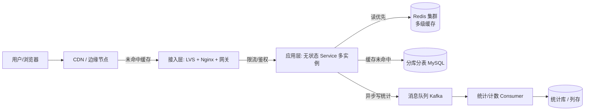
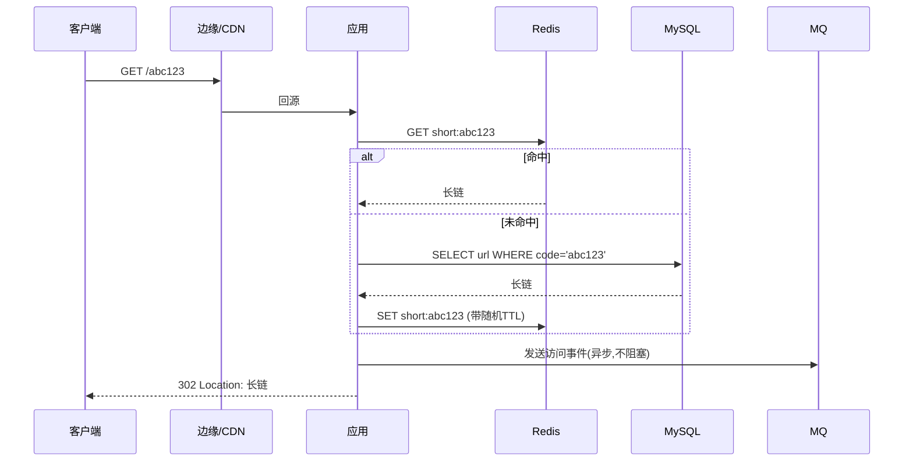
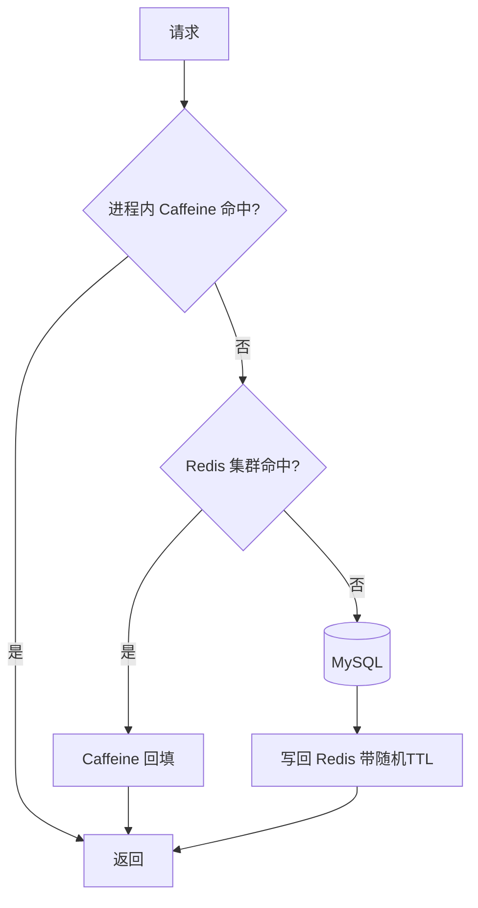

# 短网址系统 · 系统方案设计

> 文档定位：一份可直接用于架构评审 / 高级工程师面试的系统方案设计。
> 范围：长链 → 短链生成、短链 → 长链跳转、访问统计，以及背后的高并发、低延迟、缓存、高可用、容灾设计。
> 约定：文中量化指标为**假设的典型量级**，用于推导容量与选型，落地时按实际业务校准。

---

## 0. 阅读导航

| 章节 | 内容 |
|---|---|
| 1. 需求分析 | 功能 / 非功能需求与量级假设 |
| 2. 整体架构 | 分层架构与请求时序 |
| 3. 核心设计 | 短链生成、数据模型、跳转语义 |
| 4. 关键技术难点 | 海量请求 / 低延迟 / 缓存 / 高可用 / 容灾 + 补充要点 |
| 5. 容量与选型估算 | 存储 / 带宽 / 机器数粗算 |
| 6. 风险与取舍 | 关键决策点回顾 |

---

## 1. 需求分析

### 1.1 功能性需求

1. **长链转短链（写入）**：给定任意长 URL，返回一个全局唯一、长度固定的短码（如 `https://s.example.cn/abc123`）。
2. **短链跳转（读取）**：用户访问短链，系统 301/302 重定向到原始长链。
3. **可选能力**：自定义短码、短链有效期 / 过期、访问统计（PV/UV、地域、Referrer、设备）。
4. **安全**：防恶意链接（钓鱼 / 违规）、防短链被刷。

### 1.2 非功能需求（量级假设）

| 指标 | 假设值 | 说明 |
|---|---|---|
| 日新增短链（写） | 1 亿 / 天 | 峰值约 1.2w QPS |
| 短链访问（读） | 读:写 ≈ 100:1 | 峰值约 **100w QPS** |
| 跳转延迟 P99 | < 50 ms | 用户体感敏感，越低越好 |
| 可用性 | 99.99%（年停机 < 53 min） | 核心跳转不可长时间挂 |
| 数据持久性 | 99.999% | 短链映射不可丢 |
| 短码长度 | 7~8 位 | Base62 下 8 位 ≈ 2.18×10¹⁴，足够 |

> 关键结论：**短网址是典型的「读多写少、读链路极度敏感」系统**。架构重心应放在「读链路的低延迟 + 高可用 + 缓存」上，写链路追求「高吞吐 + 不丢」。

---

## 2. 整体架构

### 2.1 分层拓扑



设计原则：

- **接入层无状态**：LB 轮询，任意实例可处理任意请求，便于水平扩缩。
- **读链路尽量不下沉到 DB**：缓存命中即返回，DB 只承接「缓存未命中」的少量请求。
- **写统计异步化**：跳转计数不阻塞主链路，落 MQ 后由消费者批量落库。

### 2.2 核心请求时序（短链跳转）



---

## 3. 核心设计

### 3.1 短链生成方案（重点）

| 方案 | 原理 | 优点 | 缺点 | 适用 |
|---|---|---|---|---|
| **分布式 ID + Base62** | Snowflake/Leaf 发号 → 转 62 进制短码 | 无冲突、可顺序、易分库 | 短码含时间信息可被遍历 | ✅ 主推 |
| 哈希分桶（MD5/SHA） | 长链哈希取前 N 位 | 同长链得同短码（天然去重） | 哈希冲突需重试；分布不均 | 可选 |
| 自增 ID + Base62 | 单机自增再编码 | 极简 | 单机瓶颈、易暴露总量 | 小规模 |

**主推：分布式发号 + Base62 编码**

- 发号器用 Leaf-segment（号段模式，DB 抗抖）或 Snowflake（无中心依赖），保证全局唯一、趋势递增。
- ID → Base62 编码（`0-9a-zA-Z`，62 个字符）。ID 用 62 位足够表达约 2.18×10¹⁴ 个短码（8 位），满足海量规模。
- 生成后**先查冲突**（极低概率，因 ID 唯一基本不会冲突；哈希方案才需重试），再落库。

**去重（同长链复用短码）**：建 `UNIQUE(long_url)` 索引或先查 `SELECT code WHERE long_url=?`，命中则直接返回已有短码——节省短码空间、利于统计聚合。

### 3.2 数据模型（核心表）

```sql
CREATE TABLE short_url (
    id          BIGINT      PRIMARY KEY,       -- 发号器生成的全局 ID
    code        VARCHAR(10) NOT NULL,          -- Base62 短码, 唯一
    long_url    VARCHAR(2048) NOT NULL,        -- 原始长链
    creator_id  BIGINT,                         -- 创建者(可选)
    status      TINYINT     NOT NULL DEFAULT 1,-- 1有效 2禁用
    expire_at   DATETIME,                       -- 过期时间, NULL 不过期
    create_time DATETIME     NOT NULL,
    UNIQUE KEY uk_code (code),
    KEY idx_long_url (long_url(128))            -- 去重用前缀索引
) ENGINE=InnoDB;
```

> 读写分离 + 按 `code` 哈希**分库分表**（如 16 库 × 64 表 = 1024 分片），单分片数据量可控，扩缩容靠重新路由。

### 3.3 跳转语义：301 vs 302

| 方式 | 缓存行为 | 统计影响 | 建议 |
|---|---|---|---|
| 301 永久重定向 | 浏览器/CDN **缓存**，后续不再请求短链服务 | **统计丢失**（二次访问打不到服务端） | 不需精确统计时、追求极致低延迟用 |
| 302 临时重定向 | 每次回源 | 统计完整 | ✅ 需要访问统计时默认用 |

> 取舍：需要统计 → 302；纯降本提速且不在乎统计 → 301。实际常用 **302 + 边缘缓存短 TTL** 折中。

---

## 4. 关键技术难点

### 4.1 海量请求的处理与应对

**难点**：读峰值 100w QPS，单实例 / 单库无法承接，且写也有 1.2w QPS 持续压力。

应对策略：

1. **无状态水平扩展**：应用层不存本地状态，靠 LB 横向加机器即可线性提升吞吐。
2. **读写分离**：写走主库、读走从库；但读已被缓存挡在 DB 之前，DB 只读承接缓存未命中（< 5%）。
3. **异步削峰**：访问统计、风控打分等非核心动作进 MQ，主链路只做「查短码 → 跳转」。
4. **限流与熔断**：
   - 接入层令牌桶限流（防单 IP 刷短链）；
   - 应用层对「生成接口」做更严格限流（写成本高于读）；
   - 下游（DB/Redis）异常时熔断，快速失败或降级返回兜底页。
5. **短链预生成 / 批量发号**：热点运营活动可提前批量生成短码池，避免活动开始瞬间写洪峰。

### 4.2 低延迟要求及优化思路

**难点**：跳转 P99 < 50ms，且是用户点击外链的第一跳，延迟直接损害体验与转化。

优化思路（按收益排序）：

| 手段 | 说明 | 预期收益 |
|---|---|---|
| **边缘缓存（CDN / 边缘函数）** | 将 302 响应缓存到离用户最近的边缘节点，命中即返回，不回源 | 最大头，回源率可压到个位数 |
| 多级缓存 | 进程内(Caffeine) → 单机(Redis) → 集群，逐层拦截 | 降低 Redis 压力与 RTT |
| 连接复用 | HTTP 长连接、Redis Pipeline、DB 连接池 | 省去握手开销 |
| 短码定位直查 | `code` 唯一索引 + 分片路由，单分片一次索引命中 | 避免全表扫 |
| 避免重定向链 | 直接 302 到最终长链，不二次跳转 | 少一跳 RTT |
| 边缘地理就近 | 多地域部署，DNS 就近解析 | 跨地域 RTT 从 ~200ms 降到 ~20ms |

### 4.3 缓存设计方案（重中之重）

读多写少，缓存是系统命门。设计如下：

**缓存层级**



- **Redis 结构**：`short:{code}` → long_url，TTL 随机化（见雪崩）。
- **一致性**：写（新建/禁用短链）时**删除缓存**（Cache-Aside），下次读自动回填；禁用短链需立即失效。

**三大经典问题与对策**

| 问题 | 现象 | 对策 |
|---|---|---|
| **缓存穿透** | 查不存在的 code，每次穿透到 DB | ① 布隆过滤器拦截非法 code；② 空值也缓存（短 TTL） |
| **缓存击穿** | 某热点 code 失效瞬间，海量请求砸向 DB | ① 热点 key 不过期 / 逻辑过期；② 互斥锁（仅一个回源，其余等待） |
| **缓存雪崩** | 大量 key 同时失效，DB 被打挂 | ① TTL 加随机抖动；② 多级缓存；③ Redis 高可用（见 4.4） |

**热点 key**：爆款短链（如顶流活动）单 key 可能几十万 QPS。对策：Redis 副本读扩展 + 进程内缓存 + 边缘缓存共同吸收；必要时对该 code 做本地内存「永驻 + 被动失效」。

### 4.4 高可用设计

**目标**：无单点（No SPOF）、故障自愈、降级可用。

1. **接入层高可用**：LVS/Nginx 多实例 + 健康检查，故障自动摘除。
2. **应用层无状态**：多实例跨可用区（AZ）部署，K8s 自愈 + HPA 弹性扩容。
3. **Redis 高可用**：Redis Cluster 分片 + 每分片一主多从，主挂从晋升；哨兵/集群总线自动选主。
4. **DB 高可用**：MySQL 主从（或半同步）+ MHA / Orchestrator 自动切换；多 AZ 部署。
5. **MQ 高可用**：Kafka 多副本（replication factor ≥ 3）+ 多 AZ。
6. **优雅降级**：
   - Redis 全挂 → 直接查 DB（限流保护），跳转仍可用；
   - DB 主挂 → 从库提升前读走缓存，写暂排队；
   - 统计链路挂 → 丢弃事件，不影响跳转主链路。
7. **超时与重试**：下游调用必须设超时；重试带退避，防止雪崩式重试放大。

### 4.5 容灾设计

**目标**：地域级故障（机房/城市断电、网络分区）下仍可服务，数据可恢复。

| 维度 | 方案 |
|---|---|
| **多地域部署** | 同城双活（RPO≈0，RTO 秒级）+ 异地多活/冷备（防城市级灾难） |
| **数据复制** | MySQL 跨地域异步复制；Redis 跨地域副本；关键短链映射双写/延迟补偿 |
| **RPO / RTO** | 核心跳转 RTO < 5 min；RPO：主备异步场景下允许秒级数据丢失，靠重放 MQ 补偿 |
| **备份** | 每日全量 +  binlog 增量；备份异地存放；定期恢复演练 |
| **故障演练** | 混沌工程：定期杀 Redis 主、杀 AZ、断网，验证切换与降级 |
| **DNS 切换** | 地域级故障通过 DNS / Anycast 将流量切到健康地域 |

**容灾分级建议**：

- L1 单机故障：冗余 + 自动切换（4.4 已覆盖）。
- L2 可用区故障：跨 AZ 多活，流量自动迁移。
- L3 地域故障：异地备份 + DNS 切换，允许分钟级 RTO。

### 4.6 补充要点（其他重要难点）

1. **安全与防滥用**
   - 短链常被用于钓鱼/违规传播：**生成时服务端扫描长链**（对接安全情报库），命中黑名单直接拒绝；
   - **防刷**：生成接口按账号/IP 限流 + 人机校验；跳转接口对异常高频 code 触发风控；
   - 防短码**遍历猜解**：用 Snowflake 发号使短码无规律，避免 `abc001→abc002` 顺序可猜。
2. **数据分片与扩缩容**
   - 按 `code` 哈希分 1024 片；扩容采用「翻倍分片 + 一致性哈希」减少数据迁移；
   - 热点分片（爆款活动）可单独拆分到独立实例。
3. **访问统计的准确与成本**
   - 精确 UV 需去重：用 HyperLogLog 近似（省内存）或布隆+明细（精确但贵），按业务精度取舍；
   - 统计写 Kafka 批量落列存（ClickHouse/Doris），与主库解耦。
4. **监控与可观测性**
   - 指标：跳转 P99/P999、缓存命中率、各层错误率、Redis/DB 负载；
   - 链路追踪：跳转全链路 TraceId，便于定位慢请求；
   - 告警：命中率骤降、P99 劣化、Redis 内存水位。
5. **过期与清理**
   - 过期短链跳转返回 410；后台定时任务扫描 `expire_at` 物理清理或标记禁用，避免无限膨胀。
6. **短码长度演进**
   - 8 位 Base62 约 2.18×10¹⁴，按 1 亿/天写入可用约 600 年；真不够时升 9 位或混用大小写+符号，无需改存储结构（ID 空间足够）。

---

## 5. 容量与选型估算（粗算）

| 项 | 估算 | 备注 |
|---|---|---|
| 日写存储增量 | 1 亿 × ~220B ≈ **22 GB/天** | 含索引，按月约 660 GB |
| 年数据量 | ≈ 8 TB | 需分片 + 冷热分离（旧短链归档） |
| Redis 内存 | 热点 code 缓存 1 亿 × 2KB ≈ 200 GB | 实际只缓存热点，配集群 3 分片 × 主从 |
| 带宽（读峰值） | 100w QPS × 0.5KB ≈ **500 MB/s** | 边缘缓存吸收后回源带宽极小 |
| 应用机器 | 跳转单实例 ~5k QPS（含缓存）→ 峰值约 200 实例（留余量） | K8s 弹性，常态远低于峰值 |

---

## 6. 风险与关键取舍回顾

| 决策点 | 选择 | 理由 |
|---|---|---|
| 短码生成 | 分布式发号 + Base62 | 无冲突、可水平扩展 |
| 重定向码 | 302（需统计）/ 301（纯提速） | 按统计需求取舍 |
| 缓存策略 | Cache-Aside + 多级 + 随机 TTL | 兼顾一致性与雪崩防护 |
| 一致性 vs 可用 | 跳转主链路优先可用 | 统计可最终一致 |
| 部署 | 多 AZ 双活 + 异地备份 | 满足 99.99% 与容灾 |

---

## 7. Java 实现方案

> 本章给出以 **Java 17 + Spring Boot 3** 为主的技术实现蓝图，命名 / 分层 / 建表遵循《阿里巴巴 Java 开发手册》强制项（无外键、逻辑删除、显式列名、禁用 `SELECT *`、线程池显式构造等）。

### 7.1 具体实现方式

#### 7.1.1 项目结构与分层

```
short-url-system
├── short-url-api        # 接口层(Controller/DTO/VO)，仅暴露 HTTP 契约
├── short-url-service    # 业务层(Service/Manager)，核心逻辑与缓存编排
├── short-url-dal        # 数据层(DO/Mapper/Entity)，MyBatis-Plus + Redis
├── short-url-common     # 公共(常量/异常/工具: Base62/雪花算法/布隆)
└── short-url-infra      # 基础设施(Kafka 生产者/消费者、Redis 配置、配置中心)
```

分层职责（自上而下）：`Controller → Service → Manager → Mapper`，其中 **Manager** 封装跨数据源（DB + Redis + 发号器）的复合操作，避免 Service 直接拼装缓存与事务细节。

#### 7.1.2 关键类与方法设计

| 类 | 类型 | 关键方法 | 职责 |
|---|---|---|---|
| `ShortUrlController` | `@RestController` | `createShortUrl(CreateReq)` / `redirect(HttpServletResponse, code)` | 入参校验、302 跳转 |
| `ShortUrlService` | `@Service` | `createShortUrl()` / `resolve(code)` | 业务编排、去重、统计触发 |
| `ShortUrlManager` | `@Component` | `loadOrQuery(code)` / `saveWithCache()` | 缓存读写 + DB 落库复合操作 |
| `ShortUrlMapper` | `BaseMapper<ShortUrlDO>` | `selectByCode()` / `selectByLongUrl()` | MyBatis-Plus 数据访问 |
| `SnowflakeIdGenerator` | `@Component` | `nextId()` | 分布式发号（趋势递增） |
| `Base62Codec` | `util` | `encode(long)` / `decode(String)` | ID ↔ 短码互转 |
| `ShortUrlCache` | `@Component` | `get(code)` / `put(code,url,ttl)` / `delete(code)` | Redis 封装 + 空值防穿透 |
| `AccessEventPublisher` | `@Component` | `publish(code, ctx)` | 异步发 Kafka 访问事件 |
| `AccessEventConsumer` | `@KafkaListener` | `onMessage(event)` | 批量落统计库 |

#### 7.1.3 核心业务逻辑实现

**(1) 短码生成（生成接口）**

```java
// ShortUrlService.java（节选，遵循阿里规约：无魔法值、显式异常）
public String createShortUrl(CreateShortUrlReq req) {
    // 1. 安全扫描：长链命中黑名单直接拒绝（策略模式可插拔）
    if (securityChecker.isBlocked(req.getLongUrl())) {
        throw new BizException(ErrorCode.LONG_URL_BLOCKED);
    }
    // 2. 去重：同长链复用已有短码
    ShortUrlDO exist = shortUrlMapper.selectByLongUrl(req.getLongUrl());
    if (exist != null) {
        return buildShortUrl(exist.getCode());
    }
    // 3. 发号 + Base62 编码
    long id = snowflakeIdGenerator.nextId();
    String code = Base62Codec.encode(id);
    ShortUrlDO entity = ShortUrlDO.builder()
            .code(code).longUrl(req.getLongUrl())
            .creatorId(req.getCreatorId()).expireAt(req.getExpireAt())
            .build();
    // 4. 落库 + 写缓存（Manager 内保证一致性）
    shortUrlManager.saveWithCache(entity);
    return buildShortUrl(code);
}
```

**(2) 短链跳转（读接口，主链路低延迟）**

```java
// ShortUrlController.java
@GetMapping("/{code}")
public void redirect(@PathVariable String code, HttpServletResponse response) {
    String longUrl = shortUrlService.resolve(code);   // 缓存优先，未命中才查 DB
    if (longUrl == null) {
        response.setStatus(HttpStatus.GONE.value());   // 410：已过期/不存在
        return;
    }
    accessEventPublisher.publish(code, buildCtx());     // 异步统计，不阻塞跳转
    response.setStatus(HttpStatus.FOUND.value());       // 302
    response.setHeader(HttpHeaders.LOCATION, longUrl);
}

// ShortUrlManager.java（缓存三害防护）
public String loadOrQuery(String code) {
    String cached = redisTemplate.opsForValue().get(KEY_PREFIX + code);
    if (cached != null) {
        return BLANK.equals(cached) ? null : cached;    // 空值缓存防穿透
    }
    String lock = LOCK_PREFIX + code;
    try {
        if (tryLock(lock)) {                            // 互斥锁防击穿
            ShortUrlDO do = shortUrlMapper.selectByCode(code);
            String url = do == null ? null : do.getLongUrl();
            // 随机 TTL 防雪崩；空值也缓存短 TTL
            redisTemplate.opsForValue().set(KEY_PREFIX + code,
                    url == null ? BLANK : url, ttlWithJitter(), TimeUnit.SECONDS);
            return url;
        }
        return waitAndGet(code);                        // 未抢到锁的线程等待回填
    } finally {
        releaseLock(lock);
    }
}
```

**(3) 发号器（显式线程池，禁止 `Executors`）**

```java
// 时钟回拨用 synchronized + 等待；workerId 由配置中心/环境变量注入
public long nextId() {
    long timestamp = currentTime();
    if (timestamp < lastTimestamp) {
        throw new RuntimeException("clock moved backwards");
    }
    if (timestamp == lastTimestamp) {
        sequence = (sequence + 1) & SEQUENCE_MASK;
        if (sequence == 0) { timestamp = waitNextMillis(lastTimestamp); }
    } else { sequence = 0L; }
    lastTimestamp = timestamp;
    return ((timestamp - EPOCH) << TIMESTAMP_SHIFT)
            | (workerId << WORKER_SHIFT)
            | sequence;
}
```

> 注：3.2 的 DDL 草稿在本章落地时补全阿里强制字段，生产建表如下（含 `update_time`/`deleted`、utf8mb4、索引前缀）：

```sql
CREATE TABLE short_url (
    id           BIGINT        NOT NULL AUTO_INCREMENT COMMENT '主键',
    code         VARCHAR(10)   NOT NULL COMMENT 'Base62短码',
    long_url     VARCHAR(2048) NOT NULL COMMENT '原始长链',
    creator_id   BIGINT        DEFAULT NULL COMMENT '创建者ID',
    status       TINYINT       NOT NULL DEFAULT 1 COMMENT '1有效 2禁用',
    expire_at    DATETIME      DEFAULT NULL COMMENT '过期时间',
    create_time  DATETIME      NOT NULL DEFAULT CURRENT_TIMESTAMP COMMENT '创建时间',
    update_time  DATETIME      NOT NULL DEFAULT CURRENT_TIMESTAMP ON UPDATE CURRENT_TIMESTAMP COMMENT '更新时间',
    deleted      INT           NOT NULL DEFAULT 0 COMMENT '逻辑删除 1已删',
    PRIMARY KEY (id),
    UNIQUE KEY uk_code (code),
    KEY idx_long_url (long_url(128)),
    KEY idx_expire_at (expire_at)
) ENGINE=InnoDB DEFAULT CHARSET=utf8mb4 COMMENT='短链映射表';
```

### 7.2 环境配置

| 项 | 选型 | 说明 |
|---|---|---|
| JDK | **17（LTS）** | Spring Boot 3 最低要求；启用 ZGC 降低跳转 P99 |
| 构建工具 | **Maven 3.9**（亦可用 Gradle 8） | `maven-compiler-plugin` 指定 `17` |
| 核心框架 | Spring Boot **3.3.x** | 内嵌 Tomcat，响应式可选 WebFlux |
| ORM | **MyBatis-Plus 3.5.x** | 分页/逻辑删除/雪花 ID 内置 |
| 缓存 | **Redis 7.x**（Lettuce 客户端） | 连接池 + Pipeline |
| 消息 | **Kafka 3.x** | 访问统计异步化 |
| 监控 | **Micrometer + Prometheus** | 暴露 P99/命中率指标 |
| 部署 | **Docker 镜像 + Kubernetes** | 多副本 + HPA 弹性 + 跨 AZ |

**关键依赖（pom.xml 节选）**

```xml
<dependencies>
    <dependency>
        <groupId>org.springframework.boot</groupId>
        <artifactId>spring-boot-starter-web</artifactId>
    </dependency>
    <dependency>
        <groupId>com.baomidou.mybatisplus</groupId>
        <artifactId>mybatis-plus-spring-boot3-starter</artifactId>
        <version>3.5.7</version>
    </dependency>
    <dependency>
        <groupId>org.springframework.boot</groupId>
        <artifactId>spring-boot-starter-data-redis</artifactId>
    </dependency>
    <dependency>
        <groupId>org.springframework.kafka</groupId>
        <artifactId>spring-kafka</artifactId>
    </dependency>
    <dependency>
        <groupId>com.google.guava</groupId>
        <artifactId>guava</artifactId>             <!-- 布隆过滤器防穿透 -->
        <version>33.0.0</version>
    </dependency>
    <dependency>
        <groupId>io.micrometer</groupId>
        <artifactId>micrometer-registry-prometheus</artifactId>
    </dependency>
</dependencies>
```

**运行与部署**：`mvn package` → 产出镜像 `short-url:1.0`；K8s `Deployment` 多副本（≥3，跨 AZ），`Service` + `Ingress` 暴露；JVM 启动参数：`-Xms2g -Xmx2g -XX:+UseZGC -XX:MaxGCPauseMillis=10`。

### 7.3 开发要求

1. **编码规范（强制）**
   - 100% 遵循《阿里巴巴 Java 开发手册》强制项：类名 `UpperCamelCase`、方法/变量 `lowerCamelCase`、常量全大写下划线；**禁止魔法值**（抽 `ShortUrlConstant`）；**禁止 `SELECT *`**、`COUNT(*)`；包装类比较用 `equals`；异常禁止吞掉。
   - POJO 布尔属性不加 `is_` 前缀；`equals`/`hashCode` 成对重写；类/方法必须有 Javadoc。
   - **建表禁用外键**，关联用逻辑列 + 应用层维护；逻辑删除统一 `deleted`；表必备 `id/create_time/update_time`。
   - 线程池一律 `new ThreadPoolExecutor(...)` 显式构造，**禁止 `Executors`**；`SimpleDateFormat` 用 `DateTimeFormatter`。
2. **项目结构约定**
   - 严格四层 `api/service/manager/dal`，Manager 收口「缓存+DB+发号」复合逻辑；
   - 包命名 `com.xxx.shorturl.{module}`；DTO/VO/DO 分离，禁止在 Controller 直接返回 DO；
   - 配置外置（`application.yml` + Nacos），密钥/Redis/Kafka 地址不入库。
3. **测试要求**
   - 单测：JUnit 5 + Mockito，核心算法（`Base62Codec`/`SnowflakeIdGenerator` 单调性/冲突）覆盖率 100%；
   - 集成：`Testcontainers` 起 MySQL/Redis 跑 `resolve` 缓存三害用例；
   - 压测：`wrk`/`JMeter` 验证跳转 P99 < 50ms、100w QPS 下缓存命中率；
   - 门禁：JaCoCo 行覆盖 ≥ 70% 才允许合并；CI 跑 `spotless` + `pmd`（阿里规则集）。
4. **兼容性约束**
   - JDK **17**（不向下兼容 8/11 语法如 `var`、record、sealed 视需要）；
   - 运行环境 Linux（容器），**不依赖 Windows 特性**；字符集统一 `utf8mb4`；
   - 外部契约兼容：短码仅含 `[0-9a-zA-Z]`，保证跨端 URL 安全；返回头 `Cache-Control` 与边缘缓存约定一致；
   - 灰度：接口版本 `v1`，破坏性变更走 `v2`，旧版保留一个发布周期。

---

## 8. 开源项目推荐

> 目的：用成熟开源实现对照本文设计，取其「可借鉴的工程点」，避其「生产短板」。星标数为 2025 年公开数据，会随时间变化，仅作热度参考。

### 8.1 与本文设计的对应关系

本文方案强调「读多写少、低延迟跳转、缓存三害防护、水平扩展、高可用容灾」。下表标注各项目最值得借鉴的章节，便于按需精读源码。

### 8.2 推荐清单

| 项目 | 语言/栈 | 星标(≈) | 亮点 | 对应本文章节 |
|---|---|---|---|---|
| **ersujalsharma/url-shortener** | Java 21 + Spring Boot + MySQL + Redis | — | 「生产级」定位，含 **MySQL 分片路由 + Redis 缓存/限流 + 分布式 ID + Redis 不可用时优雅降级**，最贴合本文系统设计方案 | 3.1/4.1/4.3/4.4 |
| **dylanhu-code/url-shortener** | Java 21 + Spring Boot + PostgreSQL + Redis | — | **Redis 缓存 + Bucket4j 限流 + Docker/AWS 部署**，适合学限流与缓存落地 | 4.1/4.3 |
| **italohreis/url-shortener** | Java 21 + Spring Boot 3 + PostgreSQL | — | **Base62 生成 + @Cacheable 跳转缓存 + 点击 Analytics + Flyway + Swagger**，适合学生成与统计 | 3.1/4.6 |
| **montemurro19/url-shortener** | Java 21 + Spring Boot 3 + MySQL + Gradle | — | 带 **JWT 鉴权 + 分析看板 + 过期管理**，分层清晰（application/domain/infrastructure/presentation） | 4.6/7.1 |
| **chavesjoabe/url-shortener** | Java 17 + Spring Boot + MongoDB | — | 极简入门，REST + 重定向最小可运行，适合零基础上手 | 3/7 |
| **Shlink** | PHP(Symfony) | ~5k | 功能最全的自建方案：REST API + CLI + 多后端(MySQL/PG/SQLite) + 标签/地域 analytics + Docker | 3/4.6 |
| **YOURLS** | PHP | ~12k | 最老牌、插件生态丰富、MIT，适合做「可插拔架构」参考 | 4.6 |
| **Kutt** | Node.js/TS + React | ~11k | 现代 UI、自定义域名、API、隐私优先、MIT，适合看前端 + 短链服务一体 | 4.6 |
| **Dub** | Next.js/TS | 高 | 现代链接管理基础设施，被 Vercel/Raycast 采用，企业级 analytics/归因 | 4.6 |
| **Sink** | Vue + Cloudflare | ~7k | **100% 跑在 Cloudflare 边缘**，极佳的「边缘低延迟」反面教材（对应 4.2） | 4.2 |

### 8.3 Java/Spring Boot 重点推荐（与本文第 7 章最契合）

1. **ersujalsharma/url-shortener**（首推对照）
   - 架构与本文 2.1 几乎同构：`Client → LB → 无状态 Spring Boot → Redis(缓存/限流/发号) → Shard Router → MySQL Shards`。
   - 分布式 ID 用 **Redis `INCR` → Base62 编码**，重启安全、跨实例唯一；缓存用 **Cache-Aside**（`shortCode→longUrl`，TTL 淘汰）；写路径 **Redis 滑动窗口限流**，且 **Redis 不可用时 fail-open 保可用**——直接印证 4.3/4.4 的降级思路。
   - 短板：未涉及多地域容灾与边缘缓存，可作为 4.5 的延伸练习。
2. **dylanhu-code/url-shortener**：把「缓存 + 限流 + 容器化部署」做成最小闭环，适合照抄 `docker-compose` 与 Bucket4j 集成。
3. **italohreis/url-shortener**：Base62 + Spring Cache + Flyway 版本化建表，最适合对照 7.2 的建表与 3.1 的生成算法。
4. **montemurro19/url-shortener**：六边形/分层结构（application/domain/infrastructure/presentation）是 7.1.1 项目结构的现成范本。

### 8.4 跨语言值得借鉴的设计点

- **Shlink / YOURLS**：「插件化 + 多存储后端」的可扩展架构，对应本文 4.6 的扩展点设计。
- **Kutt / Dub**：现代短链产品的「自定义域名 + 团队 + 精细统计」产品化思路，对应 4.6 的统计与监控。
- **Sink（Cloudflare）**：把跳转直接放到边缘节点，是 4.2「边缘缓存降延迟」的极致实践——无源站也可返回 302。

### 8.5 学习建议

1. 先读 **ersujalsharma/url-shortener** 的 README 架构图，与本文第 2、4 章逐条对照，验证理解。
2. 本地 `git clone` + `docker-compose up` 跑通 **dylanhu-code** 或 **italohreis**，用 `wrk` 压测跳转，观察缓存命中率（对应 7.3 测试要求）。
3. 把本文第 7 章的 `ShortUrlManager.loadOrQuery` 与其缓存实现对比，找出差异（如是否做了空值防穿透、随机 TTL 防雪崩），补到自己的实现里。
4. 用 **Shlink** 的 API/CLI 设计反推「短链管理后台」需要哪些端点，丰富 4.6 的产品化能力。

> 仓库地址（精选）：
> - ersujalsharma/url-shortener：`https://github.com/ersujalsharma/url-shortener`
> - dylanhu-code/url-shortener：`https://github.com/dylanhu-code/url-shortener`
> - italohreis/url-shortener：`https://github.com/italohreis/url-shortener`
> - montemurro19/url-shortener：`https://github.com/montemurro19/url-shortener`
> - chavesjoabe/url-shortener：`https://github.com/chavesjoabe/url-shortener-backend`
> - Shlink：`https://github.com/shlinkio/shlink` ｜ YOURLS：`https://github.com/YOURLS/YOURLS`
> - Kutt：`https://github.com/thedevs-network/kutt` ｜ Dub：`https://github.com/dubinc/dub` ｜ Sink：`https://github.com/ccbikai/Sink`

---

## 附：关键指标速查

- 读:写 ≈ 100:1，读峰值 ~100w QPS，写峰值 ~1.2w QPS
- 跳转 P99 < 50ms；可用性 99.99%；持久性 99.999%
- 短码 8 位 Base62 ≈ 2.18×10¹⁴，可用数百年
- 缓存三害：穿透（布隆/空值）、击穿（互斥/不过期）、雪崩（随机 TTL/多级）
- 容灾三级：单机体 / AZ / 地域，对应 RTO 秒级 → 分钟级
